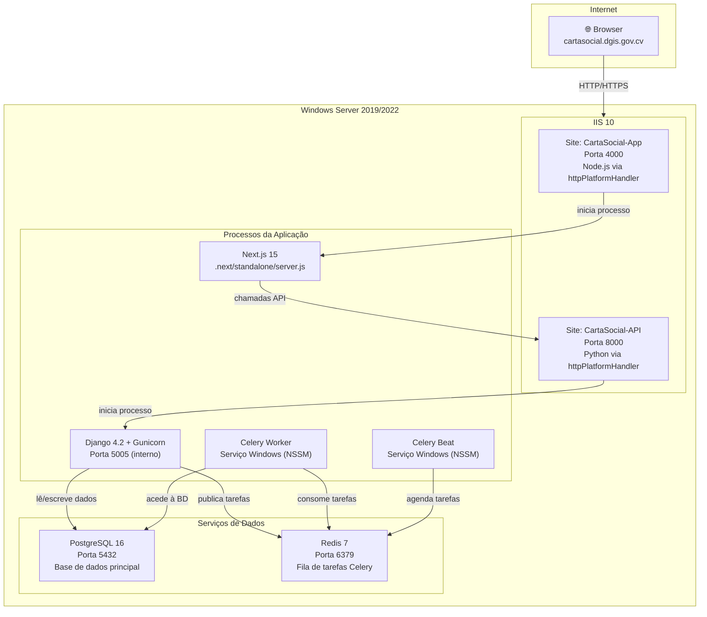

# Guia de Deploy — Carta Social (MFIDS/DGIS)

> **Versão:** 2.0 · **Data:** 2026-10-23  
> **Para quem é este guia?** Para qualquer pessoa da equipa técnica que precise instalar ou actualizar o sistema, mesmo sem experiência anterior com este servidor.

---

## Antes de começar — leia isto

Este guia explica **passo a passo** como instalar o sistema Carta Social num servidor Windows, ou como aplicar uma actualização numa instalação já existente.

**O que o sistema é, em linguagem simples:**

- O **backend** é como o "motor" — processa dados, faz cálculos, fala com a base de dados. É feito em Python/Django e corre na porta 8000.
- O **frontend** é a "interface" — o que o utilizador vê no browser. É feito em Next.js e corre na porta 4000.
- O **PostgreSQL** é a base de dados — onde ficam guardados todos os dados (organizações, equipamentos, utilizadores, etc.).
- O **Redis** é uma memória temporária — usado pelo Celery para guardar tarefas em fila de espera.
- O **Celery** é um "trabalhador em segundo plano" — executa tarefas que não precisam de resposta imediata (ex: envio de emails).
- O **IIS** é o servidor web do Windows — recebe os pedidos dos browsers e encaminha-os para o backend ou frontend.

```
Browser do utilizador
        │
        ▼
   IIS (porta 4000) ──► Next.js (frontend)
        │                      │
        │              chama API backend
        ▼
   IIS (porta 8000) ──► Python/Django (backend)
                                │
                    ┌───────────┴───────────┐
                    ▼                       ▼
              PostgreSQL               Redis + Celery
             (base de dados)        (tarefas em background)
```

**Convenções usadas neste guia:**

- `código assim` → comando para executar no terminal
- `> ⚠️ ATENÇÃO` → passo que pode causar perda de dados se feito errado
- `> 💡 PORQUÊ` → explica a razão por detrás de uma decisão
- `- [ ] item` → item de checklist a confirmar
- `🔲 A DEFINIR` → informação que a equipa precisa de preencher antes de executar

---

## Scripts prontos a usar

Os scripts PowerShell referenciados neste guia estão na pasta `scripts/` do repositório:

| Script | Quando usar |
|--------|-------------|
| `scripts/deploy-update.ps1` | Actualizar a aplicação (git pull + build + reiniciar) |
| `scripts/rollback-app.ps1` | Reverter código para versão anterior |
| `scripts/rollback-db.ps1` | Reverter base de dados para um dump anterior |
| `scripts/backup-db.ps1` | Backup manual ou agendar backup diário |
| `scripts/health-check.ps1` | Verificar saúde dos serviços (ou agendar verificação automática) |

Copia a pasta `scripts/` para `C:\apps\cartasocial\scripts\` no servidor de produção antes de executar qualquer deploy.

---

## Sumário

- [1. Glossário — O que significa cada palavra](#1-glossário--o-que-significa-cada-palavra)
- [2. Arquitectura do sistema](#2-arquitectura-do-sistema)
- [3. O que precisas antes de começar](#3-o-que-precisas-antes-de-começar)
- [4. Variáveis de ambiente e secrets](#4-variáveis-de-ambiente-e-secrets)
- [5. First Deploy — Instalação do zero](#5-first-deploy--instalação-do-zero)
  - [5.1 Preparar o servidor](#51-preparar-o-servidor)
  - [5.2 Instalar e configurar PostgreSQL](#52-instalar-e-configurar-postgresql)
  - [5.3 Instalar Redis](#53-instalar-redis)
  - [5.4 Instalar o backend Django](#54-instalar-o-backend-django)
  - [5.5 Publicar o backend no IIS](#55-publicar-o-backend-no-iis)
  - [5.6 Instalar Celery como serviço Windows](#56-instalar-celery-como-serviço-windows)
  - [5.7 Instalar e compilar o frontend Next.js](#57-instalar-e-compilar-o-frontend-nextjs)
  - [5.8 Publicar o frontend no IIS](#58-publicar-o-frontend-no-iis)
  - [5.9 Configurar firewall e fazer testes finais](#59-configurar-firewall-e-fazer-testes-finais)
- [6. HTTPS — Certificado TLS no IIS](#6-https--certificado-tls-no-iis)
- [7. Deploy de Actualizações](#7-deploy-de-actualizações)
  - [7.1 Actualização simples (sem alterações na base de dados)](#71-actualização-simples-sem-alterações-na-base-de-dados)
  - [7.2 Actualização com migrações de base de dados](#72-actualização-com-migrações-de-base-de-dados)
  - [7.3 Rollback — Reverter para a versão anterior](#73-rollback--reverter-para-a-versão-anterior)
  - [7.4 Rollback da base de dados](#74-rollback-da-base-de-dados)
- [8. Base de dados — Backups e operações](#8-base-de-dados--backups-e-operações)
- [9. Afinação do PostgreSQL para produção](#9-afinação-do-postgresql-para-produção)
- [10. Gestão de logs](#10-gestão-de-logs)
- [11. Monitorização e alertas](#11-monitorização-e-alertas)
- [12. Segurança em produção](#12-segurança-em-produção)
- [13. Resolução de problemas (Troubleshooting)](#13-resolução-de-problemas-troubleshooting)
- [14. Recuperação de desastres](#14-recuperação-de-desastres)
- [15. Ambiente de staging (testes)](#15-ambiente-de-staging-testes)
- [16. Procedimentos operacionais](#16-procedimentos-operacionais)

---

## 1. Glossário — O que significa cada palavra

Se és novo nesta área, aqui ficam as definições dos termos usados neste documento:

| Termo | O que é |
|---|---|
| **IIS** | Internet Information Services — o servidor web que vem com o Windows Server. Recebe pedidos HTTP e encaminha-os para a aplicação certa. |
| **Application Pool** | Um "contentor" dentro do IIS que isola cada aplicação. Se uma aplicação falhar, não afecta as outras. |
| **httpPlatformHandler** | Um módulo do IIS que permite correr aplicações Python ou Node.js. Sem ele, o IIS só consegue correr aplicações .NET. |
| **Gunicorn** | Um servidor WSGI Python. É o processo que realmente corre o Django em produção (mais robusto que `runserver`). |
| **venv** | Ambiente virtual Python. Isola as dependências de cada projecto para não conflituarem com outras aplicações do servidor. |
| **NSSM** | Non-Sucking Service Manager. Uma ferramenta gratuita que transforma qualquer executável num serviço Windows, permitindo que inicie automaticamente e seja reiniciado se falhar. |
| **Celery** | Biblioteca Python para processar tarefas em background (ex: enviar emails sem bloquear o utilizador). |
| **Redis** | Base de dados em memória usada como fila de mensagens. O Celery usa-o para saber quais tarefas estão à espera de ser processadas. |
| **Migration** | Script que actualiza a estrutura da base de dados quando o código da aplicação muda. |
| **collectstatic** | Comando Django que copia todos os ficheiros estáticos (CSS, JS, imagens) para uma pasta centralizada que o servidor web pode servir directamente. |
| **standalone** | Modo de build do Next.js que gera um `server.js` autónomo que não precisa de `node_modules` completo para correr. |
| **NTFS** | Sistema de ficheiros do Windows, que tem permissões granulares por utilizador/grupo. |
| **.env** | Ficheiro de texto com variáveis de ambiente (passwords, chaves de API). Nunca deve entrar no git. |
| **pg_dump** | Ferramenta do PostgreSQL para fazer backup da base de dados. |
| **PGPASSWORD** | Variável de ambiente que o PostgreSQL lê para autenticar sem pedir a password interactivamente. |

---

## 2. Arquitectura do sistema



**Portas e onde cada coisa corre:**

| Serviço | Porta | Acessível de fora? | Observação |
|---|---|---|---|
| Frontend (Next.js) | 4000 | Sim | Porta pública para utilizadores |
| Backend (Django) | 8000 | Sim | Porta pública para API |
| Gunicorn (interno) | 5005 | Não | Só o IIS fala com esta porta |
| PostgreSQL | 5432 | Não | Apenas acessível localmente |
| Redis | 6379 | Não | Apenas acessível localmente |

---

## 3. O que precisas antes de começar

### 3.1 Acesso e credenciais necessárias

Antes de começar, garante que tens:

- [ ] Acesso RDP ao servidor Windows (conta com privilégios de Administrador)
- [ ] Acesso ao repositório git (`https://github.com/EriclesBarbosa/Carta-Social-App`)
- [ ] O ficheiro de dump da base de dados de produção (se existir): `carta_social_data_db.sql`
- [ ] As passwords de produção (do gestor de passwords da equipa):
  - Password do superuser do PostgreSQL (`postgres`)
  - Password do utilizador `mfids_user` (para a base de dados)
  - Gmail App Password para envio de emails
  - DSN do Sentry (se configurado)

> 🔲 **A DEFINIR:** Confirmar quem tem acesso ao gestor de passwords e ao repositório git antes de iniciar o deploy.

### 3.2 Software a instalar no servidor

Precisas de instalar estes programas **antes** de começar os passos abaixo. Todos são gratuitos.

| # | Software | Versão | Link de download |
|---|---|---|---|
| 1 | Python | 3.11.x (64-bit) | https://python.org/downloads |
| 2 | Node.js | 18 LTS (64-bit) | https://nodejs.org |
| 3 | PostgreSQL | 16.x (64-bit) | https://www.enterprisedb.com/downloads/postgres-postgresql-downloads |
| 4 | Redis for Windows | 7.x | https://github.com/tporadowski/redis/releases |
| 5 | NSSM | 2.24+ | https://nssm.cc/download |
| 6 | Git | 2.x | https://git-scm.com |
| 7 | 7-Zip | 23.x | https://7-zip.org (para comprimir backups) |
| 8 | IIS httpPlatformHandler | 1.12 | https://www.iis.net/downloads/microsoft/httpplatformhandler |
| 9 | IIS URL Rewrite | 2.1 | https://www.iis.net/downloads/microsoft/url-rewrite |

**Ao instalar Python**, marca a opção **"Add Python to PATH"** no primeiro ecrã do instalador.

**Ao instalar Node.js**, o instalador adiciona automaticamente ao PATH.

**Ao instalar PostgreSQL**, anota a password do superuser `postgres` que defines durante a instalação.

### 3.3 Verificar se o software foi instalado correctamente

Abre o **PowerShell como Administrador** e executa:

```powershell
# Verificar Python — deve mostrar "Python 3.11.x"
python --version

# Verificar Node.js — deve mostrar "v18.x.x"
node --version

# Verificar npm — deve mostrar "10.x.x"
npm --version

# Verificar Git — deve mostrar "git version 2.x.x"
git --version

# Verificar PostgreSQL — deve mostrar o caminho para psql.exe
Get-Command psql | Select-Object -ExpandProperty Source
```

Se algum comando não for reconhecido, o software não foi instalado correctamente ou não foi adicionado ao PATH. Reinstala e garante que a opção "Add to PATH" está marcada.

### 3.4 Requisitos de hardware mínimos

| Recurso | Mínimo | Recomendado |
|---|---|---|
| CPU | 2 núcleos | 4 núcleos |
| RAM | 4 GB | 8 GB |
| Disco (sistema + app) | 60 GB SSD | 120 GB SSD |
| Disco (base de dados) | 50 GB | 200 GB SSD |

---

## 4. Variáveis de ambiente e secrets

As variáveis de ambiente são ficheiros de texto que guardam passwords e configurações sensíveis **fora do código** e **fora do git**. Isto protege as credenciais de ficarem expostas.

### 4.1 Ficheiro `.env` do backend

**Localização:** `C:\apps\cartasocial\backend\BackEnd\mfids\.env`

Este ficheiro **não existe no repositório** — tens de o criar manualmente no servidor. Aqui está o template completo:

```ini
# ─── Modo de execução ──────────────────────────────────────────────────────
# DEBUG=False em produção. Se ficar True, o Django mostra erros detalhados
# nos browsers — NUNCA fazer isso em produção.
DEBUG=False

# Chave secreta do Django — usada para encriptar sessions e tokens CSRF.
# Deve ser longa, aleatória e nunca partilhada.
SECRET_KEY=GERAR_COM_O_SCRIPT_ABAIXO

# Hosts que podem aceder ao backend. Separados por vírgula.
ALLOWED_HOSTS=backendcartasocial.dgis.gov.cv,84.247.171.243,localhost

# ─── Base de dados ─────────────────────────────────────────────────────────
DB_ENGINE=postgresql
DB_HOST=localhost
DB_PORT=5432
DB_NAME=DB_DGIS_SITE
DB_USERNAME=mfids_user
DB_PASS=PASSWORD_DA_BASE_DE_DADOS

# ─── Email ─────────────────────────────────────────────────────────────────
# Gmail App Password (não é a password da conta Google, é uma password
# de aplicação gerada em myaccount.google.com > Segurança > App Passwords)
EMAIL_HOST_PASSWORD=GMAIL_APP_PASSWORD

# ─── Celery (tarefas em background) ───────────────────────────────────────
# Endereço do Redis. Como está na mesma máquina, usamos localhost.
CELERY_BROKER_URL=redis://localhost:6379

# ─── OAuth social (login com Google / GitHub) ─────────────────────────────
# Obter em console.cloud.google.com e github.com/settings/developers
GOOGLE_CLIENT_ID=
GOOGLE_SECRET_KEY=
GITHUB_CLIENT_ID=
GITHUB_SECRET_KEY=

# ─── Monitorização de erros (Sentry) ──────────────────────────────────────
# Obter em sentry.io no projecto da equipa
DSN_KEY=

# ─── Pagamentos (Stripe) — deixar vazio se não usado ─────────────────────
STRIPE_SECRET_KEY=
STRIPE_PUBLISHABLE_KEY=
DOMAIN_URL=https://cartasocial.dgis.gov.cv/
```

### 4.2 Ficheiro `.env.local` do frontend

**Localização:** `C:\apps\cartasocial\frontend\mfids_cs_app\.env.local`

```ini
# URL do backend. Como o frontend e o backend estão na mesma máquina,
# usamos localhost. Esta variável só é usada no lado servidor do Next.js.
API_URL=http://localhost:8000
```

### 4.3 Gerar uma SECRET_KEY segura

```powershell
# Este script gera uma chave aleatória de 50 caracteres.
# Copia o resultado e cola no .env como valor de SECRET_KEY.
$chars = 'abcdefghijklmnopqrstuvwxyzABCDEFGHIJKLMNOPQRSTUVWXYZ0123456789!@#$%^&*(-_=+)'
$key = -join ((1..50) | ForEach-Object { $chars[(Get-Random -Maximum $chars.Length)] })
Write-Host "SECRET_KEY=$key"
```

**Output esperado** (exemplo — o teu será diferente):
```
SECRET_KEY=xK!9mPqL3nR@7fVwJ2hA5cBdYeZ#8gTuNs0oI4lE6vXb1WjMy
```

### 4.4 Proteger os ficheiros de configuração

Depois de criares o `.env`, restringe as permissões para que só a conta de serviço o possa ler:

```powershell
# Substitui "cartasocial_svc" pelo nome da conta de serviço que vais criar na secção 5.1
$envFile = "C:\apps\cartasocial\backend\BackEnd\mfids\.env"

# Remove todas as permissões herdadas
icacls $envFile /inheritance:r

# Permite leitura apenas à conta de serviço e ao Administrador
icacls $envFile /grant:r "cartasocial_svc:(R)"
icacls $envFile /grant:r "Administrators:(F)"

# Bloqueia explicitamente o acesso ao utilizador anónimo do IIS
icacls $envFile /deny "IUSR:(F)"
icacls $envFile /deny "IIS_IUSRS:(F)"
```

---

## 5. First Deploy — Instalação do zero

> **Tempo estimado total: ~90 minutos**
>
> Segue os passos pela ordem indicada. Cada secção depende da anterior.

### Checklist de pré-requisitos — confirma antes de começar

- [ ] Acesso RDP com conta Administrador confirmado
- [ ] Python, Node.js, PostgreSQL, Redis, NSSM, Git e 7-Zip instalados e verificados (secção 3.3)
- [ ] httpPlatformHandler e URL Rewrite instalados no IIS
- [ ] Ficheiro de dump da base de dados disponível no servidor (se aplicável)
- [ ] Todos os valores do `.env` definidos e disponíveis

---

### 5.1 Preparar o servidor

**Tempo estimado: 15 minutos**

**O que vamos fazer:** Activar o IIS, criar a estrutura de pastas do projecto e criar uma conta de serviço dedicada.

> 💡 **PORQUÊ criar uma conta de serviço?**  
> Em vez de correr a aplicação com a conta `SYSTEM` (que tem acesso total ao servidor), criamos uma conta com permissões mínimas. Se a aplicação for comprometida, o atacante ficará limitado às permissões dessa conta.

```powershell
# ── Passo 1: Activar o IIS ────────────────────────────────────────────────────
# Este comando instala o IIS e as ferramentas de gestão.
# Pode demorar 2-3 minutos. O servidor pode pedir para reiniciar.
Install-WindowsFeature -Name Web-Server, Web-Mgmt-Tools, Web-Asp-Net45 `
    -IncludeManagementTools

# Verificar se o IIS foi activado (deve aparecer "Running")
Get-Service W3SVC
```

**Output esperado:**
```
Status   Name               DisplayName
------   ----               -----------
Running  W3SVC              World Wide Web Publishing Service
```

```powershell
# ── Passo 2: Criar estrutura de pastas ────────────────────────────────────────
# Estas são as pastas onde ficará toda a aplicação, logs e backups.
$dirs = @(
    "C:\apps\cartasocial\backend",
    "C:\apps\cartasocial\frontend",
    "C:\apps\cartasocial\backups\daily",
    "C:\apps\cartasocial\logs\backend",
    "C:\apps\cartasocial\logs\frontend",
    "C:\apps\cartasocial\logs\celery",
    "C:\apps\cartasocial\scripts"
)
$dirs | ForEach-Object {
    New-Item -ItemType Directory -Path $_ -Force | Out-Null
    Write-Host "✅ Criada: $_"
}
```

```powershell
# ── Passo 3: Criar conta de serviço ───────────────────────────────────────────
# Esta conta vai correr o IIS, Celery e outros processos da aplicação.
# IMPORTANTE: substitui "SUA_SENHA_FORTE_AQUI" por uma password segura
# e guarda-a no gestor de passwords da equipa.

$svcPassword = ConvertTo-SecureString "SUA_SENHA_FORTE_AQUI" -AsPlainText -Force
New-LocalUser `
    -Name "cartasocial_svc" `
    -Password $svcPassword `
    -PasswordNeverExpires `
    -Description "Conta de servico - Carta Social" `
    -AccountNeverExpires

# Adicionar ao grupo IIS_IUSRS para que o IIS aceite esta conta
Add-LocalGroupMember -Group "IIS_IUSRS" -Member "cartasocial_svc"

Write-Host "✅ Conta cartasocial_svc criada"
```

```powershell
# ── Passo 4: Dar permissões nas pastas ────────────────────────────────────────
# A conta de serviço precisa de controlo total na pasta da aplicação.
# O grupo IIS_IUSRS só precisa de leitura+execução.
icacls "C:\apps\cartasocial" /grant "cartasocial_svc:(OI)(CI)F" /T
icacls "C:\apps\cartasocial" /grant "IIS_IUSRS:(OI)(CI)RX" /T
Write-Host "✅ Permissões configuradas"
```

**Verificação:**
- [ ] `Get-Service W3SVC` mostra `Running`
- [ ] Pasta `C:\apps\cartasocial\` existe com todas as subpastas
- [ ] Conta `cartasocial_svc` aparece em `Get-LocalUser`

---

### 5.2 Instalar e configurar PostgreSQL

**Tempo estimado: 15 minutos**

> 💡 **PORQUÊ PostgreSQL e não SQL Server?**  
> O projecto já usa PostgreSQL em produção. A base de dados tem funcionalidades específicas do PostgreSQL (como `ArrayField` e `session_replication_role`).

```powershell
# ── Passo 1: Adicionar o PostgreSQL ao PATH ───────────────────────────────────
# Se instalaste o PostgreSQL com o instalador padrão, os executáveis
# ficam em C:\Program Files\PostgreSQL\16\bin\
# Este comando adiciona essa pasta ao PATH para podermos usar psql, pg_dump, etc.

$pgBin = "C:\Program Files\PostgreSQL\16\bin"
$currentPath = [System.Environment]::GetEnvironmentVariable("PATH", "Machine")
if ($currentPath -notlike "*$pgBin*") {
    [System.Environment]::SetEnvironmentVariable("PATH", "$currentPath;$pgBin", "Machine")
    Write-Host "✅ PostgreSQL adicionado ao PATH"
} else {
    Write-Host "ℹ️  PostgreSQL já estava no PATH"
}
# Actualizar o PATH da sessão actual sem precisar reiniciar o terminal
$env:PATH = [System.Environment]::GetEnvironmentVariable("PATH", "Machine")
```

```powershell
# ── Passo 2: Criar o utilizador e a base de dados ─────────────────────────────
# Substituir "PASSWORD_DO_POSTGRES" pela password que definiste ao instalar o PostgreSQL
# Substituir "PASSWORD_MFIDS_USER" pela password do utilizador da aplicação

$env:PGPASSWORD = "PASSWORD_DO_POSTGRES"

# Criar o utilizador mfids_user
psql -U postgres -c "CREATE USER mfids_user WITH PASSWORD 'PASSWORD_MFIDS_USER';"

# Criar a base de dados e atribuí-la ao utilizador
psql -U postgres -c @"
CREATE DATABASE "DB_DGIS_SITE"
  OWNER mfids_user
  ENCODING 'UTF8'
  TEMPLATE template0;
"@

# Dar permissões completas na base de dados ao utilizador
psql -U postgres -c "GRANT ALL PRIVILEGES ON DATABASE ""DB_DGIS_SITE"" TO mfids_user;"

Write-Host "✅ Base de dados e utilizador criados"
```

**Output esperado:**
```
CREATE ROLE
CREATE DATABASE
GRANT
```

```powershell
# ── Passo 3: Restaurar dados de produção (se tiveres um dump) ─────────────────
# Se tens o ficheiro SQL com os dados, restaura-o agora.
# Se não tens dump (instalação nova), salta este passo.

# > ⚠️ ATENÇÃO: Só executar isto numa BD acabada de criar (vazia).
# Se a BD já tiver dados, este passo VAI sobrescrevê-los.

$dumpPath = "C:\apps\cartasocial\backups\carta_social_data_db.sql"

if (Test-Path $dumpPath) {
    $env:PGPASSWORD = "PASSWORD_MFIDS_USER"

    # session_replication_role='replica' desactiva temporariamente
    # as verificações de chaves estrangeiras durante o restore,
    # o que é necessário porque o dump pode não ter os dados
    # inseridos na ordem certa.
    psql -U mfids_user -d DB_DGIS_SITE `
        -c "SET session_replication_role = 'replica';" `
        -f $dumpPath
    psql -U mfids_user -d DB_DGIS_SITE `
        -c "SET session_replication_role = 'origin';"

    Write-Host "✅ Dump restaurado com sucesso"
} else {
    Write-Host "ℹ️  Nenhum dump encontrado — a base de dados ficará vazia (as migrações Django criarão as tabelas)"
}
```

```powershell
# ── Passo 4: Testar a ligação ──────────────────────────────────────────────────
$env:PGPASSWORD = "PASSWORD_MFIDS_USER"
psql -U mfids_user -d DB_DGIS_SITE -c "\dt" 2>&1
```

**Output esperado** (se restauraste um dump):
```
                 List of relations
 Schema |        Name         | Type  |   Owner
--------+---------------------+-------+------------
 public | auth_group          | table | mfids_user
 public | auth_user           | table | mfids_user
 ...
```

**Output esperado** (se base de dados está vazia):
```
Did not find any relations.
```

**Verificação:**
- [ ] `Get-Service postgresql-x64-16` mostra `Running`
- [ ] `psql -U mfids_user -d DB_DGIS_SITE -c "SELECT version();"` responde sem erros

---

### 5.3 Instalar Redis

**Tempo estimado: 10 minutos**

> 💡 **PORQUÊ o Redis como serviço Windows e não Docker?**  
> Esta instalação não usa Docker. O Redis for Windows corre como serviço nativo, o que é mais simples de gerir com as ferramentas padrão do Windows (Services, Event Viewer).

```powershell
# ── Passo 1: Extrair o Redis ──────────────────────────────────────────────────
# Descarrega o Redis for Windows de:
# https://github.com/tporadowski/redis/releases
# Extrai o ZIP para C:\apps\redis\
# Deves ter: C:\apps\redis\redis-server.exe e C:\apps\redis\redis-cli.exe

# Verifica se o executável existe
if (-not (Test-Path "C:\apps\redis\redis-server.exe")) {
    Write-Error "redis-server.exe não encontrado em C:\apps\redis\ — extrai o ZIP primeiro"
    exit 1
}
Write-Host "✅ Redis encontrado"
```

```powershell
# ── Passo 2: Registar o Redis como serviço Windows com NSSM ──────────────────
# NSSM (Non-Sucking Service Manager) transforma o redis-server.exe num
# serviço Windows que inicia automaticamente com o servidor e reinicia
# sozinho se falhar.

# Verifica se o NSSM existe (extrai de https://nssm.cc/download para C:\apps\nssm\)
$nssm = "C:\apps\nssm\win64\nssm.exe"
if (-not (Test-Path $nssm)) {
    Write-Error "nssm.exe não encontrado em C:\apps\nssm\win64\ — extrai o ZIP primeiro"
    exit 1
}

# Instalar Redis como serviço
& $nssm install Redis "C:\apps\redis\redis-server.exe"

# Configurar parâmetros:
# --port 6379         → porta padrão do Redis
# --maxmemory 256mb   → limitar uso de memória (ajustar conforme o servidor)
# --maxmemory-policy allkeys-lru → quando a memória enche, remove as chaves menos usadas
& $nssm set Redis AppParameters "--port 6379 --maxmemory 256mb --maxmemory-policy allkeys-lru"
& $nssm set Redis AppDirectory "C:\apps\redis"
& $nssm set Redis Description "Redis 7 - Broker de tarefas Celery"
& $nssm set Redis Start SERVICE_AUTO_START  # Inicia automaticamente com o Windows
& $nssm set Redis AppStdout "C:\apps\cartasocial\logs\redis-stdout.log"
& $nssm set Redis AppStderr "C:\apps\cartasocial\logs\redis-stderr.log"

# Iniciar o serviço
Start-Service Redis
Start-Sleep -Seconds 3
Get-Service Redis
```

**Output esperado:**
```
Status   Name    DisplayName
------   ----    -----------
Running  Redis   Redis
```

```powershell
# ── Passo 3: Testar o Redis ───────────────────────────────────────────────────
& "C:\apps\redis\redis-cli.exe" ping
```

**Output esperado:**
```
PONG
```

Se vires `PONG`, o Redis está a funcionar correctamente.

**Verificação:**
- [ ] `Get-Service Redis` mostra `Running`
- [ ] `redis-cli.exe ping` retorna `PONG`

---

### 5.4 Instalar o backend Django

**Tempo estimado: 20 minutos**

> 💡 **PORQUÊ usamos um ambiente virtual (`venv`)?**  
> O `venv` isola as dependências deste projecto. Se o servidor tiver outros projectos Python, os pacotes não conflituam. Além disso, a versão exacta de cada pacote fica registada no `requirements.txt`, garantindo que produção e desenvolvimento têm os mesmos pacotes.

```powershell
# ── Passo 1: Clonar o repositório ─────────────────────────────────────────────
Set-Location "C:\apps\cartasocial\backend"
git clone https://github.com/EriclesBarbosa/Carta-Social-App.git .
```

**Output esperado:**
```
Cloning into '.'...
remote: Enumerating objects: ...
Receiving objects: 100% ...
```

```powershell
# ── Passo 2: Navegar para a pasta do backend ──────────────────────────────────
Set-Location "C:\apps\cartasocial\backend\BackEnd\mfids"

# ── Passo 3: Criar ambiente virtual Python ────────────────────────────────────
# Isto cria a pasta venv_prod\ com uma cópia do Python isolada para este projecto.
python -m venv venv_prod

# Activar o ambiente virtual
# Nota: o prefixo "(venv_prod)" aparecerá no prompt enquanto estiver activo.
.\venv_prod\Scripts\Activate.ps1
```

**Output esperado** (depois de activar):
```
(venv_prod) PS C:\apps\cartasocial\backend\BackEnd\mfids>
```

```powershell
# ── Passo 4: Instalar as dependências Python ──────────────────────────────────
# O pip instala todos os pacotes listados em requirements.txt.
# Pode demorar 2-5 minutos dependendo da velocidade da internet.
python -m pip install --upgrade pip
pip install -r requirements.txt
```

**Output esperado** (no final):
```
Successfully installed Django-4.2.9 gunicorn-21.2.0 psycopg2-binary-2.9.10 ...
```

```powershell
# ── Passo 5: Criar o ficheiro .env ────────────────────────────────────────────
# Cria o ficheiro com os valores da secção 4.1.
# Podes abrir com o Notepad ou qualquer editor de texto.
notepad .env
# Preenche os valores conforme a secção 4.1 e guarda o ficheiro.
```

```powershell
# ── Passo 6: Verificar se a configuração está correcta ───────────────────────
# Este comando verifica se o Django consegue ligar à base de dados,
# se todas as variáveis estão definidas, e aponta problemas de segurança.
# Deve mostrar ZERO erros. Warnings podem ser ignorados por agora.
python manage.py check --deploy 2>&1
```

**Output esperado:**
```
System check identified some issues:

WARNINGS:
...

System check identified 1 issue (0 silenced).
```

Se aparecer **ERROR** (não WARNINGS), resolve o erro antes de continuar. Geralmente significa que uma variável do `.env` está errada ou a base de dados não está acessível.

```powershell
# ── Passo 7: Copiar ficheiros estáticos ──────────────────────────────────────
# O Django copia todos os CSS, JS e imagens para a pasta staticfiles/
# para que o servidor web os possa servir directamente.
python manage.py collectstatic --no-input
```

**Output esperado:**
```
XXX static files copied to 'C:\apps\cartasocial\backend\BackEnd\mfids\staticfiles', ...
```

```powershell
# ── Passo 8: Executar migrações da base de dados ─────────────────────────────

# SE restauraste um dump de produção:
# As tabelas já existem, então usamos --fake-initial para dizer ao Django
# "as migrações já foram aplicadas, não precisas de criar as tabelas".
python manage.py migrate --fake-initial

# SE a base de dados está vazia (sem dump):
# python manage.py migrate
# (cria todas as tabelas do zero)

# Verificar que todas as migrações estão aplicadas.
# Todas as linhas devem ter [X]. Linhas com [ ] indicam migração pendente.
python manage.py showmigrations
```

**Output esperado** (todas as migrações aplicadas):
```
api
 [X] 0001_initial
 [X] 0002_dominio_...
 ...
users
 [X] 0001_initial
 ...
 [X] 0015_profile_municipio_...
```

```powershell
# ── Passo 9: Criar o superutilizador (admin) ──────────────────────────────────
# Este utilizador terá acesso ao painel de administração Django em /admin/
# O comando vai pedir email e password interactivamente.
python manage.py createsuperuser
```

```powershell
# ── Passo 10: Testar que o Django arranca correctamente ───────────────────────
# Este é um teste temporário — o IIS vai tomar conta disto no passo seguinte.
# Depois de verificar que funciona, preme Ctrl+C para parar.
python manage.py runserver 0.0.0.0:8000
```

Abre o browser e vai a `http://localhost:8000/api/docs/`. Se vires a documentação Swagger, o Django está a funcionar.

**Verificação:**
- [ ] `python manage.py check --deploy` sem ERRORs (apenas WARNINGS são aceitáveis)
- [ ] `collectstatic` executado com sucesso
- [ ] `showmigrations` mostra todos `[X]`
- [ ] `http://localhost:8000/api/docs/` abre correctamente

---

### 5.5 Publicar o backend no IIS

**Tempo estimado: 10 minutos**

> 💡 **PORQUÊ não usar `python manage.py runserver` em produção?**  
> O `runserver` é apenas para desenvolvimento. Em produção, usamos o **Gunicorn** que é mais estável, consegue gerir múltiplos pedidos em simultâneo e não expõe informação de debug. O IIS gere o processo Gunicorn via `httpPlatformHandler`.

```powershell
# ── Passo 1: Importar o módulo de gestão do IIS ───────────────────────────────
Import-Module WebAdministration

# ── Passo 2: Criar um Application Pool dedicado ───────────────────────────────
# Um Application Pool isola a aplicação. Se o Django travar, só este pool
# é afectado — outros sites no mesmo IIS continuam a funcionar.

New-WebAppPool -Name "CartaSocial-API"

# Configurar o pool para correr com a conta de serviço
# (sem permissões de Administrador, mais seguro)
Set-ItemProperty "IIS:\AppPools\CartaSocial-API" `
    -Name "processModel.userName" -Value "cartasocial_svc"
Set-ItemProperty "IIS:\AppPools\CartaSocial-API" `
    -Name "processModel.password" -Value "SUA_SENHA_FORTE_AQUI"
Set-ItemProperty "IIS:\AppPools\CartaSocial-API" `
    -Name "processModel.identityType" -Value 3   # 3 = SpecificUser

# "No managed code" significa que o IIS não tenta gerir este processo
# como uma aplicação .NET — é Python, por isso deixamos passar tudo.
Set-ItemProperty "IIS:\AppPools\CartaSocial-API" `
    -Name "managedRuntimeVersion" -Value ""

Write-Host "✅ Application Pool CartaSocial-API criado"
```

```powershell
# ── Passo 3: Criar o Site IIS ─────────────────────────────────────────────────
$backendPath = "C:\apps\cartasocial\backend\BackEnd\mfids"

New-WebSite `
    -Name "CartaSocial-API" `
    -Port 8000 `
    -PhysicalPath $backendPath `
    -ApplicationPool "CartaSocial-API"

Write-Host "✅ Site CartaSocial-API criado na porta 8000"
```

```powershell
# ── Passo 4: Actualizar o gunicorn-cfg.py para produção ───────────────────────
# O ficheiro gunicorn-cfg.py controla como o Gunicorn funciona.
# 3 workers = consegue responder a 3 pedidos simultaneamente.
# Regra geral: workers = (2 × número de CPUs) + 1

$gunicornCfg = @"
# Porta interna onde o Gunicorn escuta.
# O IIS faz a ponte entre a porta 8000 (externa) e a 5005 (interna).
bind = '127.0.0.1:5005'

# Número de processos worker. Ajustar conforme os CPUs do servidor.
workers = 3

# Tipo de worker. 'sync' é o mais simples e adequado para esta aplicação.
worker_class = 'sync'

# Tempo máximo de resposta. Pedidos que demorem mais são cancelados.
timeout = 120

# Ficheiros de log de acesso e erro.
accesslog = 'C:/apps/cartasocial/logs/backend/access.log'
errorlog  = 'C:/apps/cartasocial/logs/backend/error.log'
loglevel  = 'warning'

capture_output = True
enable_stdio_inheritance = True
"@

Set-Content `
    "C:\apps\cartasocial\backend\BackEnd\mfids\gunicorn-cfg.py" `
    $gunicornCfg `
    -Encoding UTF8

Write-Host "✅ gunicorn-cfg.py actualizado"
```

```powershell
# ── Passo 5: Criar o web.config ───────────────────────────────────────────────
# O web.config diz ao IIS como iniciar o processo Python.
# O httpPlatformHandler usa estas configurações para lançar o Gunicorn
# quando o primeiro pedido chega.

$webConfig = @'
<?xml version="1.0" encoding="utf-8"?>
<configuration>
  <system.webServer>
    <directoryBrowse enabled="false" />
    <handlers>
      <clear />
      <add name="httpPlatformHandler"
           path="*"
           verb="*"
           modules="httpPlatformHandler"
           resourceType="Unspecified"
           requireAccess="Script" />
    </handlers>
    <httpPlatform
        processPath="C:\apps\cartasocial\backend\BackEnd\mfids\venv_prod\Scripts\python.exe"
        arguments="-m gunicorn --config gunicorn-cfg.py core.wsgi:application"
        stdoutLogEnabled="true"
        stdoutLogFile="C:\apps\cartasocial\logs\backend\gunicorn.log"
        startupTimeLimit="120"
        requestTimeout="00:05:00"
        processesPerApplication="1">
      <environmentVariables>
        <environmentVariable name="DJANGO_SETTINGS_MODULE" value="core.settings" />
        <environmentVariable name="PYTHONPATH"
            value="C:\apps\cartasocial\backend\BackEnd\mfids" />
        <environmentVariable name="PYTHONUNBUFFERED" value="1" />
      </environmentVariables>
    </httpPlatform>
    <staticContent>
      <mimeMap fileExtension=".woff2" mimeType="font/woff2" />
    </staticContent>
  </system.webServer>
</configuration>
'@

Set-Content `
    "C:\apps\cartasocial\backend\BackEnd\mfids\web.config" `
    $webConfig `
    -Encoding UTF8

Write-Host "✅ web.config criado"
```

```powershell
# ── Passo 6: Iniciar o site e testar ──────────────────────────────────────────
Start-WebSite "CartaSocial-API"
Start-Sleep -Seconds 10  # Aguarda o Gunicorn iniciar

# Testar se o backend responde
try {
    $r = Invoke-WebRequest -Uri "http://localhost:8000/api/docs/" -UseBasicParsing -TimeoutSec 30
    Write-Host "✅ Backend a responder: HTTP $($r.StatusCode)"
} catch {
    Write-Host "❌ Erro ao aceder ao backend: $($_.Exception.Message)"
    Write-Host "   Verifica os logs em: C:\apps\cartasocial\logs\backend\gunicorn.log"
}
```

**Output esperado:**
```
✅ Backend a responder: HTTP 200
```

**Verificação:**
- [ ] Application Pool `CartaSocial-API` está em `Started` no IIS Manager
- [ ] `http://localhost:8000/api/docs/` responde com HTTP 200
- [ ] Ficheiro `C:\apps\cartasocial\logs\backend\gunicorn.log` existe e sem erros críticos

---

### 5.6 Instalar Celery como serviço Windows

**Tempo estimado: 10 minutos**

> 💡 **O que são o Worker e o Beat?**  
> - O **Worker** é o processo que realmente executa as tarefas (ex: enviar um email).  
> - O **Beat** é o agendador — verifica periodicamente se há tarefas agendadas para executar e coloca-as na fila do Worker.  
> Precisamos dos dois a correr em simultâneo.

```powershell
$nssm    = "C:\apps\nssm\win64\nssm.exe"
$python  = "C:\apps\cartasocial\backend\BackEnd\mfids\venv_prod\Scripts\python.exe"
$appDir  = "C:\apps\cartasocial\backend\BackEnd\mfids"

# ══════════════════════════════════════════════════════════════════════
# Instalar o Celery WORKER
# ══════════════════════════════════════════════════════════════════════
& $nssm install CeleryWorker $python

# -A apps.tasks    → módulo Celery do projecto
# worker           → modo worker (executa tarefas)
# -l warning       → só mostra logs de nível warning ou superior
# -c 2             → 2 processos concorrentes (ajustar conforme CPUs)
& $nssm set CeleryWorker AppParameters "-m celery -A apps.tasks worker -l warning -c 2"
& $nssm set CeleryWorker AppDirectory $appDir
& $nssm set CeleryWorker AppEnvironmentExtra `
    "DJANGO_SETTINGS_MODULE=core.settings" `
    "PYTHONPATH=$appDir"
& $nssm set CeleryWorker AppStdout "C:\apps\cartasocial\logs\celery\worker-stdout.log"
& $nssm set CeleryWorker AppStderr "C:\apps\cartasocial\logs\celery\worker-stderr.log"
& $nssm set CeleryWorker Description "Celery Worker - Carta Social"
& $nssm set CeleryWorker Start SERVICE_AUTO_START
& $nssm set CeleryWorker ObjectName ".\cartasocial_svc" "SUA_SENHA_FORTE_AQUI"
& $nssm set CeleryWorker AppRestartDelay 5000  # Aguarda 5 segundos antes de reiniciar

Write-Host "✅ CeleryWorker instalado como serviço"

# ══════════════════════════════════════════════════════════════════════
# Instalar o Celery BEAT (agendador)
# ══════════════════════════════════════════════════════════════════════
& $nssm install CeleryBeat $python
& $nssm set CeleryBeat AppParameters "-m celery -A apps.tasks beat -l warning --scheduler django_celery_results.schedulers:DatabaseScheduler"
& $nssm set CeleryBeat AppDirectory $appDir
& $nssm set CeleryBeat AppEnvironmentExtra `
    "DJANGO_SETTINGS_MODULE=core.settings" `
    "PYTHONPATH=$appDir"
& $nssm set CeleryBeat AppStdout "C:\apps\cartasocial\logs\celery\beat-stdout.log"
& $nssm set CeleryBeat AppStderr "C:\apps\cartasocial\logs\celery\beat-stderr.log"
& $nssm set CeleryBeat Description "Celery Beat - Carta Social"
& $nssm set CeleryBeat Start SERVICE_AUTO_START
& $nssm set CeleryBeat ObjectName ".\cartasocial_svc" "SUA_SENHA_FORTE_AQUI"

Write-Host "✅ CeleryBeat instalado como serviço"

# ── Iniciar os serviços ───────────────────────────────────────────────────────
Start-Service CeleryWorker
Start-Service CeleryBeat
Start-Sleep -Seconds 5

Get-Service CeleryWorker, CeleryBeat | Select-Object Name, Status
```

**Output esperado:**
```
Name          Status
----          ------
CeleryWorker  Running
CeleryBeat    Running
```

**Verificação:**
- [ ] `Get-Service CeleryWorker` mostra `Running`
- [ ] `Get-Service CeleryBeat` mostra `Running`
- [ ] Logs em `C:\apps\cartasocial\logs\celery\` sem erros de ligação ao Redis

---

### 5.7 Instalar e compilar o frontend Next.js

**Tempo estimado: 15 minutos**

> 💡 **PORQUÊ `npm ci` em vez de `npm install`?**  
> `npm ci` usa o `package-lock.json` para instalar as versões **exactas** dos pacotes, sem actualizações automáticas. Em produção é sempre preferível — garante que a build usa exactamente os mesmos pacotes que foram testados em desenvolvimento.

```powershell
# ── Passo 1: Clonar o repositório (se não foi feito com o backend) ────────────
# Se já clonaste em 5.4 Passo 1 e o repositório tem tudo numa pasta,
# o frontend já está disponível. Navega para a pasta:
Set-Location "C:\apps\cartasocial\backend\mfids_cs_app"
# OU, se estiver noutra localização:
# Set-Location "C:\apps\cartasocial\frontend\mfids_cs_app"
```

```powershell
# ── Passo 2: Criar o ficheiro .env.local ──────────────────────────────────────
@"
API_URL=http://localhost:8000
"@ | Set-Content ".env.local" -Encoding UTF8
Write-Host "✅ .env.local criado"
```

```powershell
# ── Passo 3: Instalar dependências ────────────────────────────────────────────
# --legacy-peer-deps é necessário porque react-leaflet-cluster
# ainda não declarou compatibilidade com React 19, mas funciona correctamente.
npm ci --legacy-peer-deps
```

**Output esperado** (no final):
```
added XXX packages in XXs
```

```powershell
# ── Passo 4: Compilar o frontend para produção ────────────────────────────────
# Este comando processa todo o código TypeScript/React, optimiza os ficheiros
# e gera a pasta .next/standalone/ com tudo o que é necessário para produção.
# Pode demorar 2-4 minutos.
npm run build
```

**Output esperado** (no final):
```
Route (app)                              Size
┌ ○ /                                   ...
├ ○ /dashboard                          ...
...
✓ Compiled successfully
```

Se aparecerem erros TypeScript ou de compilação, consulta a secção 13 (Troubleshooting).

```powershell
# ── Passo 5: Copiar ficheiros estáticos para o standalone ─────────────────────
# O Next.js em modo standalone não inclui automaticamente as pastas
# public/ e .next/static/ — é necessário copiá-las manualmente.

$frontDir   = (Get-Location).Path
$standalone = "$frontDir\.next\standalone"

Copy-Item "$frontDir\public"       "$standalone\public"       -Recurse -Force
Copy-Item "$frontDir\.next\static" "$standalone\.next\static" -Recurse -Force

Write-Host "✅ Ficheiros estáticos copiados para standalone/"
```

```powershell
# ── Passo 6: Testar o frontend localmente ─────────────────────────────────────
$env:PORT = "4000"
$env:NODE_ENV = "production"
Set-Location "$standalone"
Start-Process node -ArgumentList "server.js" -PassThru | Out-Null
Start-Sleep -Seconds 8

try {
    $r = Invoke-WebRequest -Uri "http://localhost:4000" -UseBasicParsing -TimeoutSec 15
    Write-Host "✅ Frontend a responder: HTTP $($r.StatusCode)"
} catch {
    Write-Host "❌ Frontend não respondeu: $($_.Exception.Message)"
}
# Para o processo de teste
Get-Process node -ErrorAction SilentlyContinue | Stop-Process -Force
```

**Verificação:**
- [ ] `npm run build` concluído sem erros
- [ ] Pasta `.next/standalone/` gerada
- [ ] Pastas `public/` e `.next/static/` existem dentro de `standalone/`
- [ ] Teste local responde HTTP 200

---

### 5.8 Publicar o frontend no IIS

**Tempo estimado: 10 minutos**

```powershell
# ── Passo 1: Criar Application Pool para o frontend ──────────────────────────
Import-Module WebAdministration

New-WebAppPool -Name "CartaSocial-App"
Set-ItemProperty "IIS:\AppPools\CartaSocial-App" `
    -Name "processModel.userName" -Value "cartasocial_svc"
Set-ItemProperty "IIS:\AppPools\CartaSocial-App" `
    -Name "processModel.password" -Value "SUA_SENHA_FORTE_AQUI"
Set-ItemProperty "IIS:\AppPools\CartaSocial-App" `
    -Name "processModel.identityType" -Value 3
Set-ItemProperty "IIS:\AppPools\CartaSocial-App" `
    -Name "managedRuntimeVersion" -Value ""

Write-Host "✅ Application Pool CartaSocial-App criado"
```

```powershell
# ── Passo 2: Criar o Site IIS ─────────────────────────────────────────────────
# Ajusta o caminho conforme onde ficou o teu frontend
$standalonePath = "C:\apps\cartasocial\backend\mfids_cs_app\.next\standalone"

New-WebSite `
    -Name "CartaSocial-App" `
    -Port 4000 `
    -PhysicalPath $standalonePath `
    -ApplicationPool "CartaSocial-App"

Write-Host "✅ Site CartaSocial-App criado na porta 4000"
```

```powershell
# ── Passo 3: Criar o web.config para o frontend ───────────────────────────────
$webConfigFront = @'
<?xml version="1.0" encoding="utf-8"?>
<configuration>
  <system.webServer>
    <directoryBrowse enabled="false" />
    <handlers>
      <clear />
      <add name="httpPlatformHandler"
           path="*"
           verb="*"
           modules="httpPlatformHandler"
           resourceType="Unspecified"
           requireAccess="Script" />
    </handlers>
    <httpPlatform
        processPath="C:\Program Files\nodejs\node.exe"
        arguments="server.js"
        stdoutLogEnabled="true"
        stdoutLogFile="C:\apps\cartasocial\logs\frontend\nextjs.log"
        startupTimeLimit="60"
        requestTimeout="00:05:00"
        processesPerApplication="1">
      <environmentVariables>
        <environmentVariable name="NODE_ENV" value="production" />
        <environmentVariable name="PORT"     value="%HTTP_PLATFORM_PORT%" />
        <environmentVariable name="HOSTNAME" value="0.0.0.0" />
        <environmentVariable name="API_URL"  value="http://localhost:8000" />
      </environmentVariables>
    </httpPlatform>
  </system.webServer>
</configuration>
'@

# Ajusta o caminho do standalone conforme o teu ambiente
$standalonePath = "C:\apps\cartasocial\backend\mfids_cs_app\.next\standalone"
Set-Content "$standalonePath\web.config" $webConfigFront -Encoding UTF8
Write-Host "✅ web.config do frontend criado"
```

```powershell
# ── Passo 4: Iniciar e testar ──────────────────────────────────────────────────
Start-WebSite "CartaSocial-App"
Start-Sleep -Seconds 10

try {
    $r = Invoke-WebRequest -Uri "http://localhost:4000" -UseBasicParsing -TimeoutSec 20
    Write-Host "✅ Frontend a responder via IIS: HTTP $($r.StatusCode)"
} catch {
    Write-Host "❌ Erro: $($_.Exception.Message)"
    Write-Host "   Verifica os logs em: C:\apps\cartasocial\logs\frontend\nextjs.log"
}
```

**Verificação:**
- [ ] Application Pool `CartaSocial-App` em `Started` no IIS Manager
- [ ] `http://localhost:4000` responde com HTTP 200
- [ ] Página de login carrega correctamente no browser

---

### 5.9 Configurar firewall e fazer testes finais

**Tempo estimado: 5 minutos**

> 💡 **PORQUÊ bloquear Redis e PostgreSQL externamente?**  
> Redis e PostgreSQL não têm mecanismos de segurança tão robustos quando expostos à internet. Limitá-los a `localhost` reduz drasticamente a superfície de ataque.

```powershell
# ── Regras de firewall ────────────────────────────────────────────────────────
# Permitir acesso externo ao frontend e backend
New-NetFirewallRule -DisplayName "CartaSocial - Frontend (4000)" `
    -Direction Inbound -Protocol TCP -LocalPort 4000 -Action Allow
New-NetFirewallRule -DisplayName "CartaSocial - Backend API (8000)" `
    -Direction Inbound -Protocol TCP -LocalPort 8000 -Action Allow

# Bloquear acesso externo à base de dados e ao Redis
New-NetFirewallRule -DisplayName "CartaSocial - Bloquear Redis externo" `
    -Direction Inbound -Protocol TCP -LocalPort 6379 -Action Block
New-NetFirewallRule -DisplayName "CartaSocial - Bloquear PostgreSQL externo" `
    -Direction Inbound -Protocol TCP -LocalPort 5432 -Action Block

Write-Host "✅ Regras de firewall configuradas"
```

```powershell
# ── Testes finais — verifica todos os pontos de entrada ──────────────────────
Write-Host "`n=== TESTES FINAIS ===" -ForegroundColor Cyan

$testes = @(
    @{ Uri = "http://localhost:8000/api/docs/";   Nome = "Backend - Documentação API" },
    @{ Uri = "http://localhost:8000/api/login/";  Nome = "Backend - Endpoint de login" },
    @{ Uri = "http://localhost:4000/";            Nome = "Frontend - Página inicial" },
    @{ Uri = "http://localhost:4000/dashboard";   Nome = "Frontend - Dashboard (redireciona para login)" }
)

foreach ($t in $testes) {
    try {
        $r = Invoke-WebRequest -Uri $t.Uri -UseBasicParsing -TimeoutSec 15
        Write-Host "  ✅ $($t.Nome): HTTP $($r.StatusCode)" -ForegroundColor Green
    } catch {
        $code = $_.Exception.Response.StatusCode.value__
        if ($code -in 301, 302) {
            Write-Host "  ✅ $($t.Nome): HTTP $code (redireccionamento esperado)" -ForegroundColor Green
        } else {
            Write-Host "  ❌ $($t.Nome): $($_.Exception.Message)" -ForegroundColor Red
        }
    }
}

Write-Host "`n=== ESTADO DOS SERVIÇOS ===" -ForegroundColor Cyan
Get-Service Redis, CeleryWorker, CeleryBeat, postgresql-x64-16, W3SVC |
    Select-Object Name, Status |
    Format-Table -AutoSize
```

**Output esperado:**
```
=== TESTES FINAIS ===
  ✅ Backend - Documentação API: HTTP 200
  ✅ Backend - Endpoint de login: HTTP 405
  ✅ Frontend - Página inicial: HTTP 200
  ✅ Frontend - Dashboard: HTTP 302

=== ESTADO DOS SERVIÇOS ===
Name                 Status
----                 ------
Redis                Running
CeleryWorker         Running
CeleryBeat           Running
postgresql-x64-16    Running
W3SVC                Running
```

**Checklist final do First Deploy:**
- [ ] Todos os smoke tests passam
- [ ] Todos os 5 serviços em `Running`
- [ ] Login funcional em `http://<IP_SERVIDOR>:4000`
- [ ] Painel admin Django acessível em `http://<IP_SERVIDOR>:8000/admin/`
- [ ] Firewall configurado (portas 6379 e 5432 bloqueadas externamente)
- [ ] Ficheiro `.env` com permissões restritas (só `cartasocial_svc`)

---

## 6. HTTPS — Certificado TLS no IIS

**Tempo estimado: 15 minutos**

> 💡 **PORQUÊ HTTPS é obrigatório?**  
> Sem HTTPS, as passwords dos utilizadores viajam em texto simples pela rede. Qualquer pessoa entre o utilizador e o servidor consegue lê-las. Em produção, HTTPS não é opcional.

### 6.1 Obter um certificado

> 📋 **Estado actual (Outubro 2025):** `backendcartasocial.dgis.gov.cv` está em produção sem certificado TLS. A **Opção C (win-acme / Let's Encrypt)** é a recomendada — é gratuita, confiada por todos os browsers, e renova-se automaticamente.

Tens três opções:

---

**Opção C — Let's Encrypt via win-acme ✅ RECOMENDADA para produção**

> 💡 **O que é o Let's Encrypt?** É uma entidade sem fins lucrativos que emite certificados TLS gratuitos reconhecidos por todos os browsers. O **win-acme** é a ferramenta oficial para instalar estes certificados em Windows/IIS automaticamente.

**Pré-requisitos:**
- O servidor tem de ser acessível pela internet nas portas 80 e 443
- Os domínios `cartasocial.dgis.gov.cv` e `backendcartasocial.dgis.gov.cv` têm de apontar para o IP do servidor (verificar com `nslookup backendcartasocial.dgis.gov.cv`)
- O Windows Firewall tem de permitir entrada nas portas 80 e 443

```powershell
# ── Passo 1: Verificar se os domínios resolvem para este servidor ──────────
nslookup backendcartasocial.dgis.gov.cv
nslookup cartasocial.dgis.gov.cv
# Resultado esperado: o IP do servidor de produção (ex: 84.247.171.243)

# ── Passo 2: Garantir que a porta 80 está aberta no Firewall ──────────────
netsh advfirewall firewall add rule `
    name="HTTP para win-acme" `
    dir=in action=allow protocol=TCP localport=80

# ── Passo 3: Descarregar o win-acme ───────────────────────────────────────
# Ir a https://www.win-acme.com/ e descarregar a versão mais recente
# Ou usar PowerShell (substitui a versão conforme necessário):
$wacmeVer = "2.2.9.1701"
$wacmeUrl = "https://github.com/win-acme/win-acme/releases/download/v$wacmeVer/win-acme.v$wacmeVer.x64.pluggable.zip"
Invoke-WebRequest -Uri $wacmeUrl -OutFile "C:\apps\win-acme.zip"
Expand-Archive "C:\apps\win-acme.zip" -DestinationPath "C:\apps\win-acme"

# ── Passo 4: Executar o win-acme em modo interactivo (como Administrador) ──
# Abre uma PowerShell como Administrador e corre:
cd C:\apps\win-acme
.\wacs.exe
```

Quando o menu interactivo abrir, escolhe:

```
 M: Create certificate (full options)
   → 2: Manual input
   → Hosts: backendcartasocial.dgis.gov.cv
   → Validation: [1] Save verification files on (IIS) ... (HTTP-01)
   → Site: CartaSocial-API
   → Store: [1] IIS Central Certificate Store / [2] Windows Certificate Store
   → Installation: [1] Create or update IIS binding
```

O win-acme vai:
1. Criar um ficheiro de desafio na pasta do site IIS
2. Let's Encrypt vai verificar pela internet que o domínio aponta para este servidor
3. Emitir o certificado e instalá-lo no IIS automaticamente
4. Configurar uma tarefa agendada para renovar a cada 60 dias

```powershell
# ── Passo 5: Verificar que o certificado foi instalado ─────────────────────
Get-WebBinding -Name "CartaSocial-API" | Where-Object { $_.protocol -eq "https" }
# Resultado esperado: binding https na porta 443 com o SNI configurado

# ── Passo 6: Testar no browser ─────────────────────────────────────────────
# Abre https://backendcartasocial.dgis.gov.cv/api/docs/ → deve abrir com cadeado verde
```

> ✅ **Renovação automática:** O win-acme instala uma tarefa no Task Scheduler (`\win-acme`) que renova o certificado 30 dias antes de expirar. Não é necessário fazer nada manualmente.

---

**Opção A — Certificado da CA interna (Active Directory)**  
Usa este método se a DGIS tem uma Autoridade Certificadora interna (domínio Windows corporativo).

```powershell
# Pedir um certificado ao servidor de CA da organização
# Substitui "CA-SERVER\CA-NAME" pelo nome do teu servidor de CA
$cert = Get-Certificate `
    -Template "WebServer" `
    -SubjectName "CN=backendcartasocial.dgis.gov.cv" `
    -DnsName "cartasocial.dgis.gov.cv","backendcartasocial.dgis.gov.cv" `
    -CertStoreLocation "Cert:\LocalMachine\My" `
    -Url "ldap:"   # ou o URL do servidor de CA

Write-Host "✅ Certificado obtido: $($cert.Certificate.Thumbprint)"
```

**Opção B — Certificado auto-assinado (apenas para testes internos)**  
> ⚠️ **ATENÇÃO:** Certificados auto-assinados mostram aviso de segurança nos browsers. Nunca usar em produção acessível ao público.

```powershell
$cert = New-SelfSignedCertificate `
    -DnsName "backendcartasocial.dgis.gov.cv","cartasocial.dgis.gov.cv","localhost" `
    -CertStoreLocation "Cert:\LocalMachine\My" `
    -NotAfter (Get-Date).AddYears(2)

Write-Host "Thumbprint do certificado: $($cert.Thumbprint)"
```

### 6.2 Associar o certificado ao IIS

> **Se usaste a Opção C (win-acme):** O win-acme configura os bindings automaticamente. Podes saltar para a secção 6.3 e apenas verificar se os bindings foram criados:
> ```powershell
> Get-WebBinding | Where-Object { $_.protocol -eq "https" }
> ```

Se usaste a Opção A ou B, associa manualmente:

```powershell
Import-Module WebAdministration

# Substitui pelo Thumbprint do teu certificado (obtido no passo anterior)
$thumbprint = "THUMBPRINT_DO_CERTIFICADO_AQUI"
$cert = Get-Item "Cert:\LocalMachine\My\$thumbprint"

# ── Adicionar binding HTTPS ao site do Frontend ───────────────────────────────
New-WebBinding `
    -Name "CartaSocial-App" `
    -Protocol "https" `
    -Port 443 `
    -HostHeader "cartasocial.dgis.gov.cv" `
    -SslFlags 1

$binding = Get-WebBinding -Name "CartaSocial-App" -Protocol "https"
$binding.AddSslCertificate($cert.Thumbprint, "My")

Write-Host "✅ HTTPS configurado para CartaSocial-App"

# ── Adicionar binding HTTPS ao site do Backend (porta 8443 ou 443 com SNI) ───
New-WebBinding `
    -Name "CartaSocial-API" `
    -Protocol "https" `
    -Port 8443 `
    -HostHeader "backendcartasocial.dgis.gov.cv" `
    -SslFlags 1

$bindingApi = Get-WebBinding -Name "CartaSocial-API" -Protocol "https"
$bindingApi.AddSslCertificate($cert.Thumbprint, "My")

Write-Host "✅ HTTPS configurado para CartaSocial-API"
```

### 6.3 Forçar redireccionamento HTTP → HTTPS

Adiciona isto ao `web.config` de cada site (dentro de `<system.webServer>`):

```xml
<!-- Redireciona automaticamente HTTP para HTTPS -->
<rewrite>
  <rules>
    <rule name="HTTP to HTTPS" stopProcessing="true">
      <match url="(.*)" />
      <conditions>
        <add input="{HTTPS}" pattern="^OFF$" />
      </conditions>
      <action type="Redirect" url="https://{HTTP_HOST}/{R:1}"
              redirectType="Permanent" />
    </rule>
  </rules>
</rewrite>
```

**Verificação:**
- [ ] `https://cartasocial.dgis.gov.cv` abre sem aviso de segurança
- [ ] `https://backendcartasocial.dgis.gov.cv/api/docs/` abre sem aviso de segurança
- [ ] `http://cartasocial.dgis.gov.cv` redireciona para HTTPS automaticamente
- [ ] `http://backendcartasocial.dgis.gov.cv` redireciona para HTTPS automaticamente
- [ ] Certificado válido (cadeado verde no browser em ambos os domínios)
- [ ] (win-acme) Tarefa de renovação automática visível: `Get-ScheduledTask -TaskPath "\win-acme\"`

---

## 7. Deploy de Actualizações

> Antes de qualquer actualização, guarda sempre a resposta a estas perguntas:
> 1. Esta versão tem alterações na base de dados (novas migrations)?
> 2. Há alguma alteração em `requirements.txt` (novos pacotes Python)?
> 3. O ficheiro `package.json` foi alterado (novas dependências Node.js)?

### 7.1 Actualização simples (sem alterações na base de dados)

**Tempo estimado: 15 minutos | Downtime: ~2 minutos**

```powershell
# ════════════════════════════════════════════════════════════════════════════
# Guarda este script como: C:\apps\cartasocial\scripts\deploy-update.ps1
# Uso: .\deploy-update.ps1
# ════════════════════════════════════════════════════════════════════════════

$AppDir     = "C:\apps\cartasocial\backend\BackEnd\mfids"
$FrontDir   = "C:\apps\cartasocial\backend\mfids_cs_app"  # ajustar se necessário
$BackupDir  = "C:\apps\cartasocial\backups"
$Python     = "$AppDir\venv_prod\Scripts\python.exe"
$LogFile    = "$BackupDir\deploy-$(Get-Date -Format 'yyyyMMdd-HHmmss').log"

function Log($msg) {
    $line = "[$(Get-Date -Format 'HH:mm:ss')] $msg"
    Write-Host $line
    Add-Content $LogFile $line
}

# ── FASE 1: Backup ────────────────────────────────────────────────────────────
Log "==> 1/6 A criar snapshot de backup..."
$snapName = "snapshot-$(Get-Date -Format 'yyyyMMdd-HHmmss')"
Copy-Item $AppDir "$BackupDir\$snapName-backend" -Recurse
Log "    Backup guardado em: $BackupDir\$snapName-backend"

# ── FASE 2: Obter o novo código ───────────────────────────────────────────────
Log "==> 2/6 A actualizar o código (git pull)..."
Set-Location $AppDir
git fetch origin
git checkout main
git pull origin main
if ($LASTEXITCODE -ne 0) {
    Log "❌ git pull falhou! A cancelar."
    exit 1
}

# ── FASE 3: Actualizar dependências (só se necessário) ───────────────────────
Log "==> 3/6 A verificar dependências..."
$reqChanged = git diff HEAD@{1} HEAD -- requirements.txt
if ($reqChanged) {
    Log "    requirements.txt alterado — a instalar novos pacotes..."
    & "$AppDir\venv_prod\Scripts\pip.exe" install -r requirements.txt
}

$pkgChanged = git diff HEAD@{1} HEAD -- "../../mfids_cs_app/package.json"
if ($pkgChanged) {
    Log "    package.json alterado — a instalar dependências Node.js..."
    Set-Location $FrontDir
    npm ci --legacy-peer-deps
    Set-Location $AppDir
}

# ── FASE 4: Build do backend ──────────────────────────────────────────────────
Log "==> 4/6 A processar ficheiros estáticos do backend..."
& $Python manage.py collectstatic --no-input

# ── FASE 5: Build do frontend ─────────────────────────────────────────────────
Log "==> 5/6 A compilar o frontend..."
Set-Location $FrontDir
npm run build
Copy-Item "$FrontDir\public"       "$FrontDir\.next\standalone\public"       -Recurse -Force
Copy-Item "$FrontDir\.next\static" "$FrontDir\.next\standalone\.next\static" -Recurse -Force
Set-Location $AppDir

# ── FASE 6: Reiniciar serviços ────────────────────────────────────────────────
Log "==> 6/6 A reiniciar serviços..."
Stop-Service CeleryBeat, CeleryWorker -Force
Stop-WebSite "CartaSocial-API"
Stop-WebSite "CartaSocial-App"
Start-Sleep -Seconds 3
Start-WebSite "CartaSocial-API"
Start-WebSite "CartaSocial-App"
Start-Service CeleryWorker
Start-Service CeleryBeat
Start-Sleep -Seconds 8

# ── Smoke Test ────────────────────────────────────────────────────────────────
try {
    $r = Invoke-WebRequest -Uri "http://localhost:8000/api/docs/" -UseBasicParsing -TimeoutSec 20
    Log "✅ Deploy concluído com sucesso! Backend: HTTP $($r.StatusCode)"
    Log "   Log completo em: $LogFile"
} catch {
    Log "❌ FALHA no smoke test após deploy: $($_.Exception.Message)"
    Log "   ACÇÃO NECESSÁRIA: executar rollback (ver secção 7.3)"
    exit 1
}
```

**Verificação pós-actualização:**
- [ ] Smoke test passou (HTTP 200)
- [ ] Login funcional no frontend
- [ ] Nenhum erro novo em `C:\apps\cartasocial\logs\backend\gunicorn.log`

---

### 7.2 Actualização com migrações de base de dados

**Tempo estimado: 25 minutos | Downtime: 5–10 minutos**

> ⚠️ **ATENÇÃO:** Migrações podem alterar ou eliminar dados. Faz SEMPRE backup antes de executar. Testa em staging antes de aplicar em produção.

```powershell
$Python  = "C:\apps\cartasocial\backend\BackEnd\mfids\venv_prod\Scripts\python.exe"
$AppDir  = "C:\apps\cartasocial\backend\BackEnd\mfids"

# ── Passo 1: Backup obrigatório ───────────────────────────────────────────────
$ts = Get-Date -Format 'yyyyMMdd-HHmmss'
$dumpFile = "C:\apps\cartasocial\backups\pre-migrate-$ts.sql"

Write-Host "==> A criar backup antes das migrações..."
$env:PGPASSWORD = "PASSWORD_MFIDS_USER"
& "C:\Program Files\PostgreSQL\16\bin\pg_dump.exe" `
    -U mfids_user `
    -d DB_DGIS_SITE `
    -F plain `
    --no-owner --no-acl `
    -f $dumpFile

$tamanho = (Get-Item $dumpFile).Length / 1MB
Write-Host "✅ Backup criado: $dumpFile ($([math]::Round($tamanho,1)) MB)"

# ── Passo 2: Ver quais as migrações pendentes ─────────────────────────────────
Write-Host "`n==> Migrações pendentes (linhas com [ ]):"
Set-Location $AppDir
& $Python manage.py showmigrations | Where-Object { $_ -match '\[ \]' }

# Pausa para revisão manual
Write-Host "`nRevê as migrações acima. Continuar? (S/N)"
$resposta = Read-Host
if ($resposta -ne "S") { Write-Host "Cancelado."; exit 0 }

# ── Passo 3: Parar Celery (para evitar conflitos na BD durante a migração) ────
Write-Host "==> A parar Celery..."
Stop-Service CeleryBeat, CeleryWorker -Force
Start-Sleep -Seconds 5

# ── Passo 4: Executar migrações ───────────────────────────────────────────────
Write-Host "==> A aplicar migrações..."
& $Python manage.py migrate

if ($LASTEXITCODE -ne 0) {
    Write-Host "❌ Migração falhou! A reiniciar Celery com a versão anterior..."
    Start-Service CeleryWorker
    Start-Service CeleryBeat
    Write-Host "   Executa rollback da BD com o ficheiro: $dumpFile"
    exit 1
}

# ── Passo 5: Confirmar que tudo foi aplicado ──────────────────────────────────
Write-Host "`n==> Estado final das migrações:"
& $Python manage.py showmigrations | Where-Object { $_ -match '\[.\]' }

# ── Passo 6: Reiniciar Celery ─────────────────────────────────────────────────
Start-Service CeleryWorker
Start-Service CeleryBeat
Write-Host "✅ Migrações aplicadas com sucesso"
```

**Verificação:**
- [ ] Backup criado antes das migrações
- [ ] `showmigrations` mostra todos `[X]` após migração
- [ ] Celery reiniciado e a correr

---

### 7.3 Rollback — Reverter para a versão anterior

**Tempo estimado: 5 minutos**

> 💡 **Quando usar o rollback?**  
> Usa o rollback quando o smoke test falha após um deploy, ou quando os utilizadores reportam problemas graves. O rollback reverte o código para a versão anterior mas **NÃO reverte a base de dados** (ver secção 7.4 para isso).

```powershell
# ════════════════════════════════════════════════════════════════════════════
# Guarda como: C:\apps\cartasocial\scripts\rollback-app.ps1
# Uso: .\rollback-app.ps1 -BackupNome "snapshot-20261023-143500-backend"
# ════════════════════════════════════════════════════════════════════════════

param(
    [Parameter(Mandatory=$true, HelpMessage="Nome do snapshot de backup a restaurar")]
    [string]$BackupNome
)

$BackupDir = "C:\apps\cartasocial\backups"
$AppDir    = "C:\apps\cartasocial\backend\BackEnd\mfids"
$BackupPath = "$BackupDir\$BackupNome"

# Verificar se o backup existe
if (-not (Test-Path $BackupPath)) {
    Write-Host "❌ Backup '$BackupNome' não encontrado em $BackupDir"
    Write-Host "   Backups disponíveis:"
    Get-ChildItem $BackupDir -Filter "snapshot-*" | Select-Object Name | Format-Table
    exit 1
}

Write-Host "==> Rollback para: $BackupNome"
Write-Host "==> A parar serviços..."
Stop-Service CeleryBeat, CeleryWorker -Force
Stop-WebSite "CartaSocial-API"
Stop-WebSite "CartaSocial-App"
Start-Sleep -Seconds 3

# Mover a versão actual para uma pasta "failed" (para eventual análise)
$failedName = "failed-$(Get-Date -Format 'yyyyMMdd-HHmmss')"
Write-Host "==> A mover versão actual para $failedName..."
Rename-Item $AppDir "C:\apps\cartasocial\backend\BackEnd\$failedName"

# Restaurar a versão anterior
Write-Host "==> A restaurar versão anterior..."
Copy-Item $BackupPath $AppDir -Recurse

# Reiniciar serviços
Write-Host "==> A reiniciar serviços..."
Start-WebSite "CartaSocial-API"
Start-WebSite "CartaSocial-App"
Start-Service CeleryWorker
Start-Service CeleryBeat
Start-Sleep -Seconds 8

# Confirmar que funciona
try {
    $r = Invoke-WebRequest -Uri "http://localhost:8000/api/docs/" -UseBasicParsing -TimeoutSec 20
    Write-Host "✅ Rollback concluído! Sistema a responder: HTTP $($r.StatusCode)"
} catch {
    Write-Host "❌ Sistema ainda não responde após rollback: $($_.Exception.Message)"
    Write-Host "   Escala o incidente para o nível superior."
}
```

---

### 7.4 Rollback da base de dados

**Tempo estimado: 10–60 minutos (depende do tamanho da BD)**

> ⚠️ **ATENÇÃO CRÍTICA:** Esta operação **elimina permanentemente** todos os dados criados após o backup. É irreversível. Exige confirmação de pelo menos dois membros sénior da equipa antes de executar. Registar no sistema de gestão de incidentes.

```powershell
# ════════════════════════════════════════════════════════════════════════════
# Guarda como: C:\apps\cartasocial\scripts\rollback-db.ps1
# Uso: .\rollback-db.ps1 -DumpFile "C:\apps\cartasocial\backups\pre-migrate-20261023.sql"
# ════════════════════════════════════════════════════════════════════════════

param(
    [Parameter(Mandatory=$true)]
    [string]$DumpFile
)

if (-not (Test-Path $DumpFile)) {
    Write-Error "Ficheiro '$DumpFile' não encontrado."
    exit 1
}

$tamanho = [math]::Round((Get-Item $DumpFile).Length / 1MB, 1)
Write-Host "╔══════════════════════════════════════════════════════════════╗"
Write-Host "║            ⚠️  ROLLBACK DA BASE DE DADOS                    ║"
Write-Host "║                                                              ║"
Write-Host "║  Isto vai APAGAR todos os dados desde o backup.             ║"
Write-Host "║  Esta acção é IRREVERSÍVEL.                                 ║"
Write-Host "║                                                              ║"
Write-Host "║  Ficheiro de restore: $DumpFile"
Write-Host "║  Tamanho: $tamanho MB"
Write-Host "╚══════════════════════════════════════════════════════════════╝"
Write-Host ""
$aprovacao1 = Read-Host "Aprovação 1 — Escreve o teu nome para confirmar"
$aprovacao2 = Read-Host "Aprovação 2 — Segundo membro sénior escreve o nome"
$confirmacao = Read-Host "Para confirmar, escreve exactamente: CONFIRMO ROLLBACK"

if ($confirmacao -ne "CONFIRMO ROLLBACK") {
    Write-Host "Cancelado — confirmação incorrecta."
    exit 0
}

Write-Host "==> Aprovado por: $aprovacao1 e $aprovacao2 em $(Get-Date)"
Write-Host "==> A parar todos os serviços com acesso à BD..."
Stop-Service CeleryBeat, CeleryWorker -Force
Stop-WebSite "CartaSocial-API"
Start-Sleep -Seconds 8

Write-Host "==> A terminar sessões activas na base de dados..."
$env:PGPASSWORD = "POSTGRES_SUPERUSER_PASS"
psql -U postgres -c @"
SELECT pg_terminate_backend(pid)
FROM pg_stat_activity
WHERE datname = 'DB_DGIS_SITE'
  AND pid <> pg_backend_pid();
"@

Write-Host "==> A apagar e recriar a base de dados..."
psql -U postgres -c 'DROP DATABASE "DB_DGIS_SITE";'
psql -U postgres -c @"
CREATE DATABASE "DB_DGIS_SITE"
  OWNER mfids_user
  ENCODING 'UTF8'
  TEMPLATE template0;
"@

Write-Host "==> A restaurar dados do backup (pode demorar vários minutos)..."
$env:PGPASSWORD = "MFIDS_USER_PASS"
psql -U mfids_user -d DB_DGIS_SITE `
    -c "SET session_replication_role = 'replica';" `
    -f $DumpFile
psql -U mfids_user -d DB_DGIS_SITE `
    -c "SET session_replication_role = 'origin';"

Write-Host "==> A reiniciar serviços..."
Start-WebSite "CartaSocial-API"
Start-Service CeleryWorker
Start-Service CeleryBeat

Write-Host "✅ Rollback da base de dados concluído."
Write-Host "   Regista este incidente com: aprovadores=$aprovacao1/$aprovacao2, dump=$DumpFile"
```

---

## 8. Base de dados — Backups e operações

### 8.1 Backup manual

```powershell
# Cria um backup completo da base de dados em formato SQL
# Guarda o ficheiro com timestamp para fácil identificação
$ts = Get-Date -Format 'yyyyMMdd-HHmmss'
$destino = "C:\apps\cartasocial\backups\manual-$ts.sql"

$env:PGPASSWORD = "MFIDS_USER_PASS"
& "C:\Program Files\PostgreSQL\16\bin\pg_dump.exe" `
    -U mfids_user `
    -d DB_DGIS_SITE `
    -F plain `
    --no-owner `
    --no-acl `
    -f $destino

$mb = [math]::Round((Get-Item $destino).Length / 1MB, 2)
Write-Host "✅ Backup criado: $destino ($mb MB)"
```

### 8.2 Agendar backup automático diário

```powershell
# Guarda o script de backup em C:\apps\cartasocial\scripts\backup-daily.ps1
$scriptBackup = @'
$ts      = Get-Date -Format 'yyyyMMdd-HHmmss'
$backDir = "C:\apps\cartasocial\backups\daily"
New-Item -ItemType Directory -Path $backDir -Force | Out-Null

# Backup da base de dados
$env:PGPASSWORD = "MFIDS_USER_PASS"
$dumpFile = "$backDir\DB_DGIS_SITE-$ts.sql"
& "C:\Program Files\PostgreSQL\16\bin\pg_dump.exe" `
    -U mfids_user -d DB_DGIS_SITE -F plain --no-owner --no-acl -f $dumpFile

# Comprimir com 7-Zip para poupar espaço
& "C:\Program Files\7-Zip\7z.exe" a "$dumpFile.gz" $dumpFile
Remove-Item $dumpFile  # Remove o SQL não comprimido

# Apagar backups com mais de 30 dias
Get-ChildItem $backDir -Filter "*.gz" |
    Where-Object { $_.LastWriteTime -lt (Get-Date).AddDays(-30) } |
    Remove-Item -Force

Write-EventLog -LogName Application -Source "CartaSocial" `
    -EventId 5010 -EntryType Information `
    -Message "Backup diário concluído: $dumpFile.gz"
'@

Set-Content "C:\apps\cartasocial\scripts\backup-daily.ps1" $scriptBackup -Encoding UTF8

# Registar como tarefa agendada — executa todos os dias às 02:00
$action   = New-ScheduledTaskAction -Execute "powershell.exe" `
    -Argument "-NonInteractive -ExecutionPolicy Bypass -File C:\apps\cartasocial\scripts\backup-daily.ps1"
$trigger  = New-ScheduledTaskTrigger -Daily -At 02:00
$settings = New-ScheduledTaskSettingsSet -RunOnlyIfNetworkAvailable -StartWhenAvailable

Register-ScheduledTask `
    -TaskName "CartaSocial-BackupDiario" `
    -Action $action `
    -Trigger $trigger `
    -Settings $settings `
    -RunLevel Highest `
    -User "SYSTEM"

Write-Host "✅ Backup automático agendado para as 02:00 diariamente"
```

### 8.3 Exportar permissões de grupos

> ⚠️ As permissões dos grupos de utilizadores estão **apenas na base de dados** (não estão no código). Se recriares a base de dados do zero, perdes estas configurações. Exporta-as regularmente:

```powershell
Set-Location "C:\apps\cartasocial\backend\BackEnd\mfids"
$python = ".\venv_prod\Scripts\python.exe"

# Exportar grupos e permissões para um ficheiro JSON
& $python manage.py dumpdata auth.Group auth.Permission `
    --indent 2 `
    --output fixtures\groups_permissions.json

Write-Host "✅ Permissões exportadas para fixtures\groups_permissions.json"
Write-Host "   Guarda este ficheiro no repositório git ou num local seguro."
```

Para importar numa base de dados nova:

```powershell
& $python manage.py loaddata fixtures\groups_permissions.json
```

### 8.4 Marcar migration de seed como aplicada

A migration `api/0005` (seed de faixa etária) foi aplicada manualmente via SQL. Em servidores novos que recebam o dump de produção, marca-a como aplicada para evitar que o Django tente executá-la novamente:

```powershell
Set-Location "C:\apps\cartasocial\backend\BackEnd\mfids"
.\venv_prod\Scripts\python.exe manage.py migrate --fake api 0005
Write-Host "✅ Migration api/0005 marcada como aplicada"
```

---

## 9. Afinação do PostgreSQL para produção

**Ficheiro a editar:** `C:\Program Files\PostgreSQL\16\data\postgresql.conf`

> 💡 **PORQUÊ afinar o PostgreSQL?**  
> Os valores padrão do PostgreSQL são muito conservadores (para funcionar em máquinas com apenas 1 GB de RAM). Num servidor dedicado com 8 GB ou mais, aumentar estes valores melhora significativamente a performance.

```powershell
# Abre o ficheiro de configuração no Notepad
notepad "C:\Program Files\PostgreSQL\16\data\postgresql.conf"
```

Localiza e altera estas linhas (ou adiciona-as no final do ficheiro se não existirem):

```ini
# ─── Memória ───────────────────────────────────────────────────────────────
# shared_buffers: ~25% da RAM total do servidor
# Para 8 GB de RAM → 2GB; para 4 GB → 1GB
shared_buffers = 2GB

# work_mem: memória para operações de ordenação por sessão
# Cuidado: pode ser usado por múltiplas sessões simultâneas
work_mem = 64MB

# maintenance_work_mem: memória para operações de manutenção (VACUUM, CREATE INDEX)
maintenance_work_mem = 256MB

# effective_cache_size: estimativa da memória total disponível para cache
# Para 8 GB de RAM → 6GB
effective_cache_size = 6GB

# ─── Conexões ──────────────────────────────────────────────────────────────
# Limitar ao necessário — cada conexão ocupa ~5-10 MB de RAM
# Gunicorn (3 workers) + Celery (2 workers) + administração = ~20 conexões
max_connections = 50

# ─── Logs ──────────────────────────────────────────────────────────────────
# Registar queries lentas (mais de 2 segundos) para identificar problemas
log_min_duration_statement = 2000   # em milissegundos
log_line_prefix = '%t [%p]: [%l-1] '
logging_collector = on
log_directory = 'log'
log_filename = 'postgresql-%Y-%m-%d.log'
log_rotation_age = 1d
log_rotation_size = 100MB
```

```powershell
# Após guardar o ficheiro, reinicia o PostgreSQL para aplicar as alterações
Restart-Service postgresql-x64-16
Write-Host "✅ PostgreSQL reiniciado com novas configurações"
```

---

## 10. Gestão de logs

### 10.1 Estrutura de logs do sistema

```
C:\apps\cartasocial\logs\
├── backend\
│   ├── gunicorn.log      ← erros de inicialização do Django/Gunicorn
│   ├── access.log        ← todos os pedidos HTTP ao backend
│   └── error.log         ← erros do Django em produção
├── frontend\
│   └── nextjs.log        ← erros do processo Node.js
├── celery\
│   ├── worker-stdout.log ← output do Celery Worker
│   ├── worker-stderr.log ← erros do Celery Worker
│   ├── beat-stdout.log   ← output do Celery Beat
│   └── beat-stderr.log   ← erros do Celery Beat
├── health-YYYYMMDD.log   ← resultados do health check diário
└── deploy-TIMESTAMP.log  ← log de cada deploy efectuado
```

### 10.2 Ler os logs mais recentes

```powershell
# Ver os últimos 50 erros do backend
Get-Content "C:\apps\cartasocial\logs\backend\error.log" -Tail 50

# Ver os últimos pedidos ao backend
Get-Content "C:\apps\cartasocial\logs\backend\access.log" -Tail 30

# Ver erros do frontend
Get-Content "C:\apps\cartasocial\logs\frontend\nextjs.log" -Tail 50

# Ver erros do Celery
Get-Content "C:\apps\cartasocial\logs\celery\worker-stderr.log" -Tail 30
```

### 10.3 Rotação automática de logs (limpar logs antigos)

```powershell
# Guarda como C:\apps\cartasocial\scripts\rotate-logs.ps1
$scriptRotacao = @'
$logDir = "C:\apps\cartasocial\logs"
$diasRetencao = 30

Get-ChildItem $logDir -Recurse -File -Include "*.log" |
    Where-Object { $_.LastWriteTime -lt (Get-Date).AddDays(-$diasRetencao) } |
    ForEach-Object {
        Remove-Item $_.FullName -Force
        Write-Host "Removido: $($_.FullName)"
    }

# Logs do IIS (pasta padrão)
Get-ChildItem "C:\inetpub\logs\LogFiles" -Recurse -File -Include "*.log" |
    Where-Object { $_.LastWriteTime -lt (Get-Date).AddDays(-$diasRetencao) } |
    Remove-Item -Force
'@

Set-Content "C:\apps\cartasocial\scripts\rotate-logs.ps1" $scriptRotacao -Encoding UTF8

# Agendar para executar semanalmente ao Domingo às 03:00
$action  = New-ScheduledTaskAction -Execute "powershell.exe" `
    -Argument "-NonInteractive -File C:\apps\cartasocial\scripts\rotate-logs.ps1"
$trigger = New-ScheduledTaskTrigger -Weekly -DaysOfWeek Sunday -At 03:00

Register-ScheduledTask `
    -TaskName "CartaSocial-RotacaoLogs" `
    -Action $action `
    -Trigger $trigger `
    -RunLevel Highest `
    -User "SYSTEM"

Write-Host "✅ Rotação de logs agendada para domingos às 03:00"
```

### 10.4 Configurar logs IIS

```powershell
# Activar logs detalhados no IIS e configurar rotação diária
Import-Module WebAdministration

# Rotação diária (um ficheiro por dia)
Set-WebConfigurationProperty `
    -pspath 'MACHINE/WEBROOT/APPHOST' `
    -filter "system.applicationHost/sites/siteDefaults/logFile" `
    -name "period" -value "Daily"

# Limite de 100 MB por ficheiro de log
Set-WebConfigurationProperty `
    -pspath 'MACHINE/WEBROOT/APPHOST' `
    -filter "system.applicationHost/sites/siteDefaults/logFile" `
    -name "truncateSize" -value 104857600

Write-Host "✅ Logs IIS configurados com rotação diária"
```

---

## 11. Monitorização e alertas

### 11.1 Health check automático diário

```powershell
# Guarda como C:\apps\cartasocial\scripts\health-check.ps1
$scriptHealth = @'
# Registar source de eventos se ainda não existir
if (-not [System.Diagnostics.EventLog]::SourceExists("CartaSocial")) {
    New-EventLog -LogName Application -Source "CartaSocial"
}

$logFile = "C:\apps\cartasocial\logs\health-$(Get-Date -Format 'yyyyMMdd').log"
$falhas  = @()

function Verificar($nome, $uri) {
    try {
        $r = Invoke-WebRequest -Uri $uri -UseBasicParsing -TimeoutSec 10
        $linha = "[$(Get-Date -Format 'HH:mm:ss')] ✅ $nome : HTTP $($r.StatusCode)"
        $linha | Add-Content $logFile
        Write-Host $linha
    } catch {
        $linha = "[$(Get-Date -Format 'HH:mm:ss')] ❌ $nome : $($_.Exception.Message)"
        $linha | Add-Content $logFile
        Write-Host $linha -ForegroundColor Red
        $script:falhas += $nome
        Write-EventLog -LogName Application -Source "CartaSocial" `
            -EventId 5000 -EntryType Error `
            -Message "FALHA no endpoint: $nome ($uri) - $($_.Exception.Message)"
    }
}

function VerificarServico($nome) {
    $svc = Get-Service $nome -ErrorAction SilentlyContinue
    if ($null -eq $svc) {
        $linha = "[$(Get-Date -Format 'HH:mm:ss')] ⚠️  Serviço '$nome' não encontrado"
        $linha | Add-Content $logFile
        $script:falhas += "Serviço:$nome"
    } elseif ($svc.Status -ne "Running") {
        $linha = "[$(Get-Date -Format 'HH:mm:ss')] ❌ Serviço $nome : $($svc.Status)"
        $linha | Add-Content $logFile
        $script:falhas += "Serviço:$nome"
        Write-EventLog -LogName Application -Source "CartaSocial" `
            -EventId 5001 -EntryType Warning `
            -Message "Serviço $nome não está Running (Status: $($svc.Status))"
    } else {
        "[$(Get-Date -Format 'HH:mm:ss')] ✅ Serviço $nome : Running" | Add-Content $logFile
    }
}

# Verificar endpoints
Verificar "Backend API"  "http://localhost:8000/api/docs/"
Verificar "Frontend App" "http://localhost:4000/"

# Verificar serviços Windows
@("Redis","CeleryWorker","CeleryBeat","postgresql-x64-16","W3SVC") | ForEach-Object {
    VerificarServico $_
}

# Resumo
if ($falhas.Count -gt 0) {
    $msg = "Health check com $($falhas.Count) falha(s): $($falhas -join ', ')"
    Write-EventLog -LogName Application -Source "CartaSocial" `
        -EventId 5099 -EntryType Error -Message $msg
    Write-Host $msg -ForegroundColor Red
} else {
    Write-EventLog -LogName Application -Source "CartaSocial" `
        -EventId 5100 -EntryType Information -Message "Health check OK - todos os serviços a funcionar"
    Write-Host "✅ Health check OK" -ForegroundColor Green
}
'@

Set-Content "C:\apps\cartasocial\scripts\health-check.ps1" $scriptHealth -Encoding UTF8

# Agendar para as 08:00 e 20:00 todos os dias
$action   = New-ScheduledTaskAction -Execute "powershell.exe" `
    -Argument "-NonInteractive -File C:\apps\cartasocial\scripts\health-check.ps1"
$trigger1 = New-ScheduledTaskTrigger -Daily -At 08:00
$trigger2 = New-ScheduledTaskTrigger -Daily -At 20:00
$settings = New-ScheduledTaskSettingsSet -RunOnlyIfNetworkAvailable

Register-ScheduledTask `
    -TaskName "CartaSocial-HealthCheck" `
    -Action $action `
    -Trigger @($trigger1, $trigger2) `
    -Settings $settings `
    -RunLevel Highest `
    -User "SYSTEM"

Write-Host "✅ Health check agendado para as 08:00 e 20:00"
```

### 11.2 Consultar alertas no Event Viewer

```powershell
# Ver todos os erros das últimas 24 horas
Get-EventLog -LogName Application -EntryType Error `
    -After (Get-Date).AddHours(-24) |
    Select-Object TimeGenerated, Source, EventID, Message |
    Format-Table -AutoSize -Wrap

# Ver apenas alertas do Carta Social
Get-EventLog -LogName Application -Source "CartaSocial" |
    Select-Object -Last 20 |
    Format-Table -AutoSize

# Abrir o Event Viewer graficamente
eventvwr.msc
```

---

## 12. Segurança em produção

### 12.1 Verificação de segurança Django

```powershell
Set-Location "C:\apps\cartasocial\backend\BackEnd\mfids"
.\venv_prod\Scripts\python.exe manage.py check --deploy
```

O Django verifica automaticamente várias configurações de segurança. Em produção, **não devem existir ERRORs** — apenas WARNINGS são aceitáveis.

Configurações de segurança a adicionar ao `.env`:

```ini
# Força HTTPS — utilizadores em HTTP são automaticamente redireccionados
SECURE_SSL_REDIRECT=True

# HSTS diz ao browser para usar sempre HTTPS durante 1 ano
SECURE_HSTS_SECONDS=31536000
SECURE_HSTS_INCLUDE_SUBDOMAINS=True
SECURE_HSTS_PRELOAD=True

# Cookies só viajam por HTTPS
SESSION_COOKIE_SECURE=True
CSRF_COOKIE_SECURE=True
```

### 12.2 Cabeçalhos de segurança HTTP

Adiciona ao `web.config` dos dois sites (dentro de `<system.webServer>`):

```xml
<httpProtocol>
  <customHeaders>
    <!-- Impede o browser de "adivinhar" o tipo de ficheiro (proteção XSS) -->
    <add name="X-Content-Type-Options"    value="nosniff" />
    <!-- Impede que a página seja embutida num iframe (proteção clickjacking) -->
    <add name="X-Frame-Options"           value="DENY" />
    <!-- Activa o filtro XSS do browser -->
    <add name="X-XSS-Protection"          value="1; mode=block" />
    <!-- Controla que informação é enviada na origem dos pedidos -->
    <add name="Referrer-Policy"           value="strict-origin-when-cross-origin" />
    <!-- Remove cabeçalhos que revelam tecnologias usadas -->
    <remove name="X-Powered-By" />
    <remove name="Server" />
  </customHeaders>
</httpProtocol>
```

### 12.3 Verificação periódica de segurança

```powershell
# Executar mensalmente — verifica se há actualizações de segurança nos pacotes Python
Set-Location "C:\apps\cartasocial\backend\BackEnd\mfids"
.\venv_prod\Scripts\pip.exe list --outdated

# Verificar vulnerabilidades conhecidas com pip-audit
.\venv_prod\Scripts\pip.exe install pip-audit
.\venv_prod\Scripts\pip-audit.exe
```

---

## 13. Resolução de problemas (Troubleshooting)

### Problema 1: Backend retorna HTTP 502 ou 503

**O que significa:** O IIS não consegue comunicar com o Gunicorn.

```powershell
# 1. Verificar se o Application Pool está a correr
Import-Module WebAdministration
(Get-WebConfiguration "system.applicationHost/applicationPools/add[@name='CartaSocial-API']").state
# Esperado: "Started"

# 2. Ver os últimos erros do Gunicorn
Get-Content "C:\apps\cartasocial\logs\backend\gunicorn.log" -Tail 50

# 3. Testar se o Python consegue iniciar o Gunicorn manualmente
Set-Location "C:\apps\cartasocial\backend\BackEnd\mfids"
.\venv_prod\Scripts\python.exe -m gunicorn --config gunicorn-cfg.py core.wsgi:application
# Se der erro aqui, o problema está no código ou na configuração

# 4. Verificar se o .env está correcto
Get-Content .env

# 5. Reiniciar apenas o Application Pool do backend
Restart-WebAppPool "CartaSocial-API"
Start-Sleep -Seconds 5
Invoke-WebRequest -Uri "http://localhost:8000/api/docs/" -UseBasicParsing
```

### Problema 2: Frontend mostra página em branco ou erro

```powershell
# 1. Ver os logs do processo Node.js
Get-Content "C:\apps\cartasocial\logs\frontend\nextjs.log" -Tail 50

# 2. Confirmar que os ficheiros estáticos foram copiados
$standalone = "C:\apps\cartasocial\backend\mfids_cs_app\.next\standalone"
Test-Path "$standalone\.next\static"     # deve ser True
Test-Path "$standalone\public"           # deve ser True

# Se False, copia-os agora:
$frontDir = "C:\apps\cartasocial\backend\mfids_cs_app"
Copy-Item "$frontDir\public"       "$standalone\public"       -Recurse -Force
Copy-Item "$frontDir\.next\static" "$standalone\.next\static" -Recurse -Force

# 3. Testar o Node.js manualmente
Set-Location $standalone
$env:PORT = "4000"; $env:NODE_ENV = "production"
node server.js
# Abre http://localhost:4000 no browser para ver o erro exacto
```

### Problema 3: Celery não processa tarefas

```powershell
# 1. Verificar se os serviços estão a correr
Get-Service CeleryWorker, CeleryBeat | Select-Object Name, Status

# 2. Ver os logs de erro
Get-Content "C:\apps\cartasocial\logs\celery\worker-stderr.log" -Tail 30

# 3. Verificar se o Redis está acessível
& "C:\apps\redis\redis-cli.exe" ping
# Deve retornar: PONG
# Se retornar erro, o Redis não está a correr

# 4. Ver tarefas na fila do Redis
& "C:\apps\redis\redis-cli.exe" llen celery

# 5. Testar o Celery manualmente para ver erros
Set-Location "C:\apps\cartasocial\backend\BackEnd\mfids"
$env:DJANGO_SETTINGS_MODULE = "core.settings"
$env:PYTHONPATH = (Get-Location).Path
.\venv_prod\Scripts\python.exe -m celery -A apps.tasks inspect active

# 6. Reiniciar na ordem correcta (Redis primeiro, depois Celery)
Restart-Service Redis
Start-Sleep -Seconds 3
Restart-Service CeleryWorker
Restart-Service CeleryBeat
```

### Problema 4: Erro de ligação à base de dados

```powershell
# 1. Verificar se o PostgreSQL está a correr
Get-Service postgresql-x64-16 | Select-Object Status

# 2. Testar a ligação directamente
$env:PGPASSWORD = "MFIDS_USER_PASS"
psql -U mfids_user -d DB_DGIS_SITE -c "SELECT NOW();"
# Deve mostrar a data/hora actual

# 3. Ver quantas conexões estão abertas
psql -U postgres -c "SELECT count(*) FROM pg_stat_activity WHERE datname='DB_DGIS_SITE';"
# Se estiver perto do limite de max_connections, pode ser o problema

# 4. Ver os logs do PostgreSQL
$logDir = "C:\Program Files\PostgreSQL\16\data\log"
Get-ChildItem $logDir | Sort-Object LastWriteTime -Descending |
    Select-Object -First 1 | Get-Content -Tail 30

# 5. Reiniciar o PostgreSQL (atenção: interrompe todas as conexões)
Restart-Service postgresql-x64-16
```

### Problema 5: Página de erro do Django em vez da aplicação

Se aparecer o ecrã de erro laranja/amarelo do Django com traceback, significa que `DEBUG=True` no `.env`. Em produção, isto não deve acontecer:

```powershell
# Verificar o valor de DEBUG no .env
Get-Content "C:\apps\cartasocial\backend\BackEnd\mfids\.env" |
    Where-Object { $_ -match "DEBUG" }

# Se mostrar DEBUG=True, altera para False:
(Get-Content ".env") -replace "^DEBUG=True", "DEBUG=False" |
    Set-Content ".env"

# Reiniciar o backend
Restart-WebAppPool "CartaSocial-API"
```

### Problema 6: "This site can't be reached" no browser

```powershell
# 1. Verificar se os sites IIS estão iniciados
Get-WebSite | Select-Object Name, State, Bindings

# 2. Verificar se as portas estão a escutar
netstat -ano | Select-String ":8000|:4000"

# 3. Verificar regras de firewall
Get-NetFirewallRule -DisplayName "CartaSocial*" |
    Select-Object DisplayName, Enabled, Action

# 4. Iniciar sites que estejam parados
Start-WebSite "CartaSocial-API"
Start-WebSite "CartaSocial-App"
```

---

## 14. Recuperação de desastres

### 14.1 O que fazer se o servidor ficar completamente inacessível

**Cenário:** O servidor não liga, não responde a RDP, ou foi completamente perdido.

**Tempo de recuperação esperado:** 2–4 horas (com backups disponíveis)

```
PASSO 1: Provisionar novo servidor Windows Server 2019/2022
         Tempo: 30–60 min (depende da infra)

PASSO 2: Seguir o First Deploy (secção 5) no novo servidor
         Tempo: ~60 min

PASSO 3: Restaurar base de dados do último backup diário
         Tempo: 15–30 min
         Usar: rollback-db.ps1 com o backup mais recente de
               C:\apps\cartasocial\backups\daily\

PASSO 4: Verificar que o sistema funciona
         Tempo: 5–10 min
         Executar os smoke tests da secção 5.9
```

### 14.2 Objectivos de recuperação

| Métrica | Valor | O que significa |
|---|---|---|
| **RPO** (Recovery Point Objective) | 24 horas | O máximo de dados que podemos perder — o backup do dia anterior |
| **RTO** (Recovery Time Objective) | 4 horas | O tempo máximo para voltar a funcionar |

> 🔲 **A DEFINIR:** Se a DGIS tiver SLA mais apertado, é necessário implementar backups mais frequentes (a cada hora) ou replicação em tempo real.

### 14.3 Localização dos backups

| Tipo | Localização | Retenção |
|---|---|---|
| Backup diário BD | `C:\apps\cartasocial\backups\daily\` | 30 dias |
| Backup manual BD | `C:\apps\cartasocial\backups\` | Indefinido (apagar manualmente) |
| Snapshots de código | `C:\apps\cartasocial\backups\snapshot-*` | Até 10 versões (apagar manualmente) |

> ⚠️ **ATENÇÃO:** Os backups locais não protegem contra falha de disco do servidor. Configura uma cópia dos backups para um servidor externo, NAS ou cloud storage.

---

## 15. Ambiente de staging (testes)

> 💡 **O que é o staging?**  
> É uma cópia do sistema de produção onde podes testar actualizações antes de as aplicar aos utilizadores reais. Evita que bugs cheguem a produção.

### 15.1 Diferenças entre staging e produção

| Configuração | Produção | Staging |
|---|---|---|
| `DEBUG` | `False` | `True` (opcional) |
| Base de dados | `DB_DGIS_SITE` | `DB_DGIS_STAGING` |
| Porta frontend | 4000 | 4001 |
| Porta backend | 8000 | 8001 |
| Email real | Sim | Não (usar `EMAIL_BACKEND=django.core.mail.backends.console.EmailBackend`) |

### 15.2 Configurar ambiente de staging

```powershell
# 1. Criar base de dados de staging
$env:PGPASSWORD = "POSTGRES_SUPERUSER_PASS"
psql -U postgres -c "CREATE DATABASE ""DB_DGIS_STAGING"" OWNER mfids_user ENCODING 'UTF8' TEMPLATE template0;"

# 2. Copiar dados de produção para staging (opcional — para testes realistas)
# ⚠️ Atenção: remove dados pessoais antes de partilhar o staging com a equipa de dev
$env:PGPASSWORD = "MFIDS_USER_PASS"
pg_dump -U mfids_user -d DB_DGIS_SITE -F plain --no-owner --no-acl |
    psql -U mfids_user -d DB_DGIS_STAGING

# 3. Criar .env separado para staging
# (igual ao de produção mas com DB_NAME=DB_DGIS_STAGING e DEBUG=True)
```

```powershell
# 4. Criar sites IIS separados para staging
New-WebAppPool -Name "CartaSocial-API-Staging"
New-WebSite -Name "CartaSocial-API-Staging" `
    -Port 8001 `
    -PhysicalPath "C:\apps\cartasocial-staging\backend\BackEnd\mfids" `
    -ApplicationPool "CartaSocial-API-Staging"

New-WebAppPool -Name "CartaSocial-App-Staging"
New-WebSite -Name "CartaSocial-App-Staging" `
    -Port 4001 `
    -PhysicalPath "C:\apps\cartasocial-staging\frontend\mfids_cs_app\.next\standalone" `
    -ApplicationPool "CartaSocial-App-Staging"
```

---

## 16. Procedimentos operacionais

### 16.1 Reinício ordenado do sistema (manutenção programada)

> A ordem é importante: para primeiro o que depende dos outros, inicia primeiro o que os outros dependem.

```powershell
Write-Host "=== A PARAR o sistema ===" -ForegroundColor Yellow
# Frontend primeiro (não tem dependências de outros serviços da app)
Stop-WebSite "CartaSocial-App"
# Backend a seguir
Stop-WebSite "CartaSocial-API"
# Celery depois (depende do Redis e do Django)
Stop-Service CeleryBeat  -Force
Stop-Service CeleryWorker -Force
# Redis por último dos serviços da app (Celery depende dele)
Stop-Service Redis -Force
# PostgreSQL só parar se for absolutamente necessário
# Stop-Service postgresql-x64-16

Write-Host "=== Sistema parado ===" -ForegroundColor Red
```

```powershell
Write-Host "=== A INICIAR o sistema ===" -ForegroundColor Yellow
# PostgreSQL primeiro (a BD tem de estar disponível antes de tudo o resto)
# Start-Service postgresql-x64-16
# Start-Sleep -Seconds 5

# Redis a seguir (o Celery precisa dele)
Start-Service Redis
Start-Sleep -Seconds 3

# Celery a seguir (precisa do Redis e da BD)
Start-Service CeleryWorker
Start-Service CeleryBeat
Start-Sleep -Seconds 3

# Backend (precisa da BD e do Redis)
Start-WebSite "CartaSocial-API"
Start-Sleep -Seconds 8

# Frontend por último (chama o backend)
Start-WebSite "CartaSocial-App"
Start-Sleep -Seconds 5

Write-Host "=== Sistema iniciado ===" -ForegroundColor Green
Get-Service Redis, CeleryWorker, CeleryBeat, W3SVC | Select-Object Name, Status
```

### 16.2 Checklist completa de deploy

**Antes do deploy:**
- [ ] Código revisto e aprovado via pull request no GitHub
- [ ] Deploy testado em staging (se disponível)
- [ ] Backup da base de dados efectuado (`secção 8.1`)
- [ ] Snapshot do directório de código efectuado
- [ ] Janela de manutenção comunicada aos utilizadores (ex: email ou aviso no sistema)
- [ ] Todos os membros da equipa necessários disponíveis

**Durante o deploy:**
- [ ] `git pull` executado sem conflitos
- [ ] `pip install` executado (se `requirements.txt` mudou)
- [ ] `collectstatic` executado sem erros
- [ ] Migrações de BD aplicadas (se aplicável)
- [ ] `npm ci` + `npm run build` executados sem erros
- [ ] Ficheiros estáticos do Next.js copiados para `standalone/`
- [ ] Serviços reiniciados na ordem correcta

**Depois do deploy:**
- [ ] Smoke tests passam (HTTP 200 nos endpoints principais)
- [ ] Login funcional no browser
- [ ] Nenhum erro novo nos logs de erro
- [ ] Nenhum erro novo no Event Viewer
- [ ] Deploy registado no sistema de gestão de mudanças

### 16.3 Janelas de manutenção recomendadas

| Tipo de deploy | Quando fazer | Downtime típico | Aprovação necessária |
|---|---|---|---|
| Hotfix urgente (sem migração BD) | A qualquer hora | ~2 min | 1 responsável técnico |
| Actualização normal (com migração BD) | Fora de horas úteis (22h–06h) | ~10 min | 1 responsável técnico |
| Actualização major | Fim-de-semana, com 48h de aviso prévio | ~20 min | Responsável técnico + gestor |
| Rollback de base de dados | Emergência apenas | 10–60 min | 2 membros sénior |

### 16.4 Contactos de escalada

> 🔲 **A DEFINIR:** Preencher com os contactos reais da equipa DGIS antes de ir para produção.

| Função | Nome | Contacto | Disponível |
|---|---|---|---|
| DevOps / Infra Lead | A DEFINIR | — | 24/7 |
| DBA (Gestor de BD) | A DEFINIR | — | Horário laboral + on-call |
| Responsável pela Aplicação | A DEFINIR | — | Horário laboral |
| Suporte Windows Server | A DEFINIR | — | Horário laboral |
| Gestor do Projecto | A DEFINIR | — | Horário laboral |

---

*Este documento deve ser revisto e actualizado sempre que:*
- *Houver uma alteração significativa na arquitectura*
- *Um deploy major for efectuado*
- *Um incidente for resolvido com procedimentos novos*

*Versão 2.0 — 2026-10-23*
